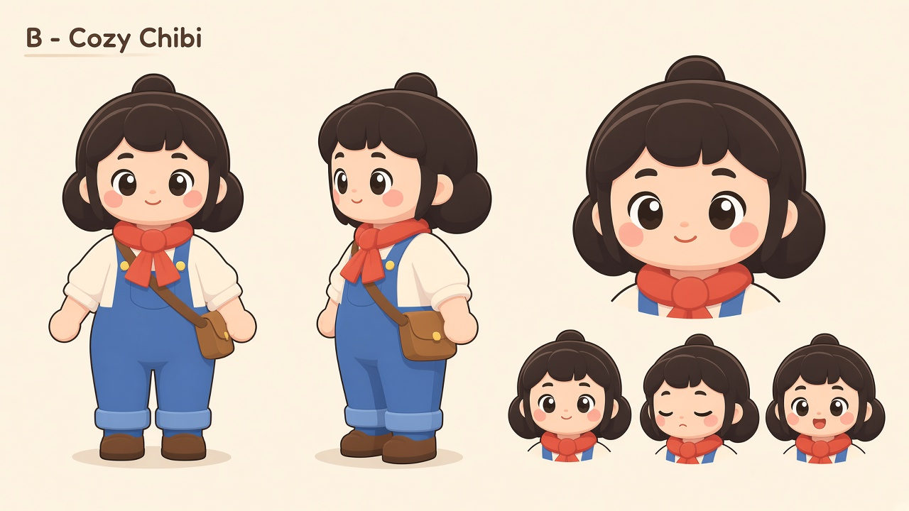
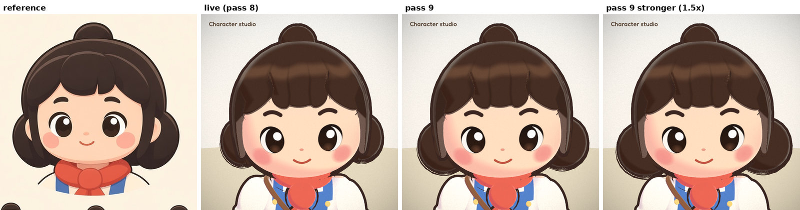
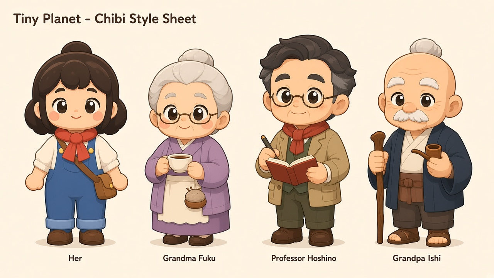
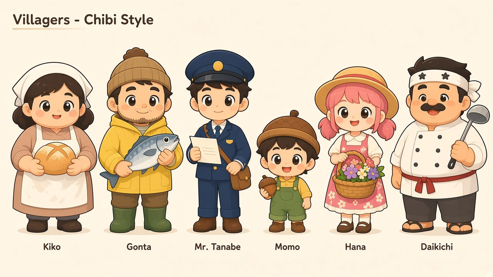
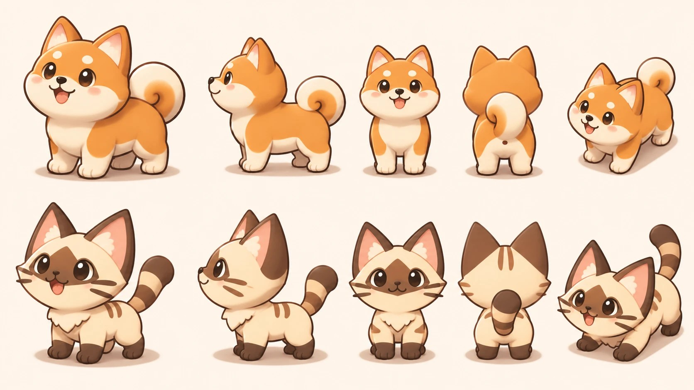

# Cozy Chibi character design (Tiny Planet)

**Optional interactive face review:** when KT requests the face builder, start `npm run facebuilder -- --char her|fuku|ishi|hoshino --wait` (choose one ID), give KT the printed URL, and wait for `FACE_BUILDER_SUBMITTED`. Read the approval receipt and continue from the saved source; preserve the locked appearance. See [Face Builder workflow](facebuilder.md). The normal game build and review workflow are unchanged.

In-repo design reference for Tiny Planet humans in the approved Cozy Chibi style (concept B). Taken from her (the player).

Use this when designing or implementing a human in the approved "Cozy Chibi" style (concept B). Do **not** build villagers from this document until KT asks. This is the style and implementation reference taken from her (the player).

## Character template (locked by KT, pass 12): start every new chibi here

Her current build is **the template for every future chibi character**. A new character starts from this look and these
numbers, and changes only what its concept sheet asks for (see section 4). Golden reference for her: [`ref/her-turnaround-satchel.jpg`](ref/her-turnaround-satchel.jpg).


**What is locked** (source of truth `src/art/chibi/ChibiHer.jsx`; numbers are in the head frame unless stated):

| Area | Locked choice |
|---|---|
| Face features | Pass 8 eyes; pass 10 layout (eye line `E10Y -0.0048`, `E10X -0.0009`; nose dot, mouth and blush follow); brows line width `0.0040 * s` |
| Skin | `#f3bf98` |
| Profile (nose and chin) | `MIDFACE`: an oval column `[-0.0278, 0.0397, 0.02, 0.0058, 0.014, 0.0012, 0.001]` (the step out under the eye and the flat front) and a chin ellipsoid `[-0.0345, 0.0303, 0.03, 0.0162, 0.0243, 0.0055]`; `MID_FADE = 0`. Shading and AO ignore these shapes, so the front view is just the painted nose dot. Side view: a soft step under the eye, a short flat front past the mouth, a gradual curve into the chin |
| Hair | Pass 11 continuous lobe (`flare()`, `FL 0.34`, `FL_BACK 0.25`; no side-puff spheres), helmet `RH [0.069, 0.0712, 0.0668]`, slim side locks (azimuth ±1.04..±1.42, tip -0.041), top bun unchanged |
| Ears | Small flat skin ovals `[0.0042, 0.0122, 0.0076]` at `EAR {x 0.068, y -0.0165, z 0.0025}`, turned forward 0.75, no ink |
| Body | Pass 3/4 proportions; ankle `anY 0.044`, `leg 0.96`; boots `bootH 1.45`, `bootL 1.04`, `soleY`, `bootShaft`, shoe `#83492a` with a painted sole and welt |
| Outfit | Shirt `#f7ead3`, denim `#4271b8`, scarf `#d9503f`; flat rolled sleeve and jeans cuffs (`SLEEVE_GEO`, `CUFF_GEO`); ribbon scarf tails; painted seams (`outfit.seams`) |
| Satchel | `satchel.js`, `BAG_S 0.079`, wide flat strap |
| Cost | Studio 26 draw calls; head 19 calls / ~57.2k tris in the face close-up |

**How to judge a new character against the template**

1. Run the dev server (`npm run dev`) and take the standard review set with `node tools/chibi-shots.mjs <outDir>`: a four-angle turnaround plus the face from ten angles (front round to the side on both sides, a face-framed side, and two downward game-camera views). Build the same two sheets as above for the new character and show them side by side with its concept sheet and with her sheets.
2. Always check 3/4 and deep 3/4 as well as the side. Every profile change in this pass first went wrong in 3/4 (a beak, then a muzzle). Narrow face shapes stick out in 3/4; keep any profile shape broad (rx >= 0.02) and judge it from all ten angles.
3. Offer KT small, equal steps to pick from rather than one guess (the profile here was chosen from a ladder of 0.0006 steps). Show options side by side; commit only the one KT picks.
4. Check the game camera and a walk cycle before calling it done (hair through shoulders, bag against the swinging arm).

## Approved baseline

- **Pass 8** (face and eyes): live on `main` as merge `56a09bd`. Face layout is pass 6 subtle (`FT = 1`); the iris, crescent and lid line are pass 8.
- **Pass 9** (side buns): live on `main` as merge `efc30e1` (from branch `chibi-her-buns`, commit `a701b8a`). Face, eyes, top bun and fringe are unchanged from pass 8.
- **Pass 10** (turnaround sheet, satchel + hair/face/body details): golden reference [`ref/her-turnaround-satchel.jpg`](ref/her-turnaround-satchel.jpg); before/after [`ref/pass10-turnaround-compare.jpg`](ref/pass10-turnaround-compare.jpg). Approved by KT as part of the template (see below).
  - Satchel (`src/art/chibi/satchel.js`, via the optional `ext.Bag` hook): top handle, stitched flap with two buckled straps, side pockets with a daisy and a scroll, plaid blanket roll with two ties, gold compass charm. One vertex-coloured cel mesh + one ink hull (still 2 draws). Placement `BAG_AT` in `ChibiHer.jsx`; flat wide strap via `ext.strap[6]` / `ext.strapC`.
  - Face: eye line lower (`E10Y = -0.0048`) and a touch closer (`E10X = -0.0009`); nose, mouth and blush follow (`F10` scales it).
  - Hair: wider, rounder dome (`RH = [0.069, 0.0712, 0.0668]`), broad straight side locks from azimuth ±0.9 down to the jaw (they frame the face as on the sheet), fuller back volume, side puffs stretched front-to-back so they read as the bob's curled hem. Ears are still left out.
  - Body: sheet palette (shirt `#f7ead3`, denim `#4271b8`, scarf `#d9503f`), rolled sleeve cuffs (`ext.sleeveGeo`), broad notched scarf tails hanging down (`ext.tailGeo`, `ext.tails`, `ext.tailX`), painted overalls seams (`outfit.seams`: bib pocket rim, fly, hip pockets, bib top). All hooks default to the old look for villagers.
  - Cost: draw calls unchanged (studio 26); her tris ~59.4k -> ~64.7k; startup entry +0.3 KB gz (hooks only).
- **Pass 11** (KT feedback on pass 10): before/after [`ref/pass11-turnaround-compare.jpg`](ref/pass11-turnaround-compare.jpg). Approved by KT as part of the template (see below).
  - Hair: the separate side-puff spheres are gone. The helmet's lower band flares out horizontally (`flare()`, round profile, `FL` at the sides easing to `FL_BACK` behind, zero across the face and side locks), so the sides and back are one continuous lobe with one ink hull; the flare rides the side springs (`aW` 0/1). Rows bunch toward the hem (`NT = 18`), denser azimuths behind. Do not carve a niche for the ears (it folded the shell into ink shards).
  - Ears are back (skin, `aSkin = 1`, `EAR`), resting on the hair just behind the side locks, above the flare.
  - Rolled sleeves and jeans cuffs are flat folded bands (lathe profiles, `SLEEVE_GEO` band and `ext.cuffGeo`), not round donuts.
  - Satchel `BAG_S` 0.1 -> 0.088.
  - Boots: optional body knobs `anY` (ankle up 0.01, with `leg` 1.06 -> 0.96 so the hip stays put), `footY`, `soleY` (flat sole cut), `bootShaft` (chunky ankle); `bootH` 1.45, `bootL` 1.04, `shoeY` 0.05, shoe `#83492a`; a darker painted sole band with a welt line (`outfit.seams`). All knobs default to the old foot.
  - Cost: draw calls unchanged (studio 26); her tris ~64.7k -> ~67.5k; startup entry +0.2 KB gz.
- **Pass 12** (KT feedback on pass 11): before/after [`ref/pass12-turnaround-compare.jpg`](ref/pass12-turnaround-compare.jpg). Approved by KT as part of the template (see below).
  - Kept pass 11's continuous lobe (KT preferred it over the pass-10 puffs after trying both).
  - Side locks slimmer again (azimuth ±1.04..±1.42, tip -0.041).
  - Ears small and flat against the head, turned forward (`EAR`, radii 0.0042 / 0.0094 / 0.0072), not round balls.
  - Nose (12c, KT: no bump; use the face contour, as in the sheet's side view): `MIDFACE` in `ChibiHer.jsx` is a soft swell of the mid-face around the nose, blended into the head (body knob `midface`, also in the decal's `headSDF`). In profile the line dips under the eye, comes out to a rounded nose point and slopes back to the mouth and chin. The body bake shades it with the normals and AO of the head without the swell (`S.mf` is skipped there), so from the front the face looks exactly as before; only the silhouette and its ink change.
  - Nose 12h (KT drew the profile line): straight down from under the eye, a sharp step out, a vertical front that stays forward down past the mouth, then a gradual curve into the chin. `MIDFACE` entries are ellipsoids `[y, z, rx, ry, rz, k]` or oval columns `[y, z, rx, hy, rz, k, r]` (the 7th value is an edge radius); the step and the vertical front are an oval column, a tall ellipsoid under it starts the chin curve. Same in the body bake (`ocol`) and the decal's `headSDF`. The bake grid (~0.004 head units) softens the step into a short ramp. 12i/12j (KT): the chin ellipsoid is fuller so below the mouth the profile rolls back into the chin in one continuous arc; 12j halves the extra fullness (`[-0.0345, 0.0376, 0.0134, 0.0162, 0.0203, 0.0055]`; the 12i chin sagged).
  - 12k (KT: 3/4 looked like a bird): the narrow nose box and chin stuck out of the face like a beak in 3/4. Now the step is an oval column (wide cross-section, rx 0.02, so its sides round back into the cheeks) and the chin ellipsoid is wide (rx 0.03): a broad flat lower face, as in the sheet's 3/4, with the same profile. Judge any MIDFACE change from 3/4 as well as the side.
  - 12l (KT: 3/4 a bit like a monkey): softer and less forward. Column rx 0.016, edge r 0.002, blend k 0.0035, a touch further back; chin ellipsoid 0.0014 further back with a softer blend (k 0.0075). The profile keeps its step, vertical front and chin curve, slightly softer.
  - 12m (KT: smoother in 3/4, side view untouched): every MIDFACE shape recedes by `MID_FADE * x^2` (16, head frame; body knob `midfaceFade`) away from the centre line, and the shapes are wider (rx 0.03 / 0.038) so the fade, not their edges, sets how they meet the cheeks. Zero on the centre line, so the profile is exactly unchanged. To soften 3/4 further, raise `MID_FADE`; it never changes the side view.
  - 12n tried `MID_FADE` 28; KT kept 16. Limit for later: a strong fade turns the swell into a thin keel down the centre line, whose side becomes a real contour in 3/4 and picks up a line of ink by the mouth (faint at 30, plain at 34+), and at 45+ the keel is finer than the bake grid so the profile weakens. Thinning the hull's ink on the keel's flanks was tried and broke the profile outline; do not repeat it.
  - Locked (KT): the 12k shapes moved back 0.0033 (`MIDFACE` nose z 0.0397, chin z 0.0303), `MID_FADE = 0`. Picked from a ladder of 0.0006 steps; this is halfway between options C and D. The 12l softening and the 12m-12n fades remain available (raise `MID_FADE` to ease the swells into the cheeks in 3/4; it never changes the profile).
  - Ears longer vertically (ry 0.0122); brows a touch thicker (line width 0.0040).
  - Skin `#f3bf98` (warmer, deeper peach measured off the sheet; was `#f7d3b8`).
  - Satchel `BAG_S` 0.079.
- Source of truth: `src/art/chibi/ChibiHer.jsx` and the optional hooks in `src/GhibliPerson.jsx`.
- Canonical picture: [`ref/her-B-chibi.jpg`](ref/her-B-chibi.jpg).
- Approved in-game eye and bun shots: [`ref/pass8-eye-closeup.jpg`](ref/pass8-eye-closeup.jpg), [`ref/pass9-front-compare.jpg`](ref/pass9-front-compare.jpg).
- Cast and villager concept sheets (per-character hair, colours, age, outfit — not a licence to start them): [`ref/chibi-sheet-main-cast.jpg`](ref/chibi-sheet-main-cast.jpg) (Her, Grandma Fuku, Professor Hoshino, Grandpa Ishi) and [`ref/chibi-sheet-villagers.jpg`](ref/chibi-sheet-villagers.jpg) (Kiko, Gonta, Mr. Tanabe, Momo, Hana, Daikichi). Ishi's sheet has a stray bun glitch; do not copy it.

**Grandma Fuku, pass 8** (draft, dev-only: `?view=charstudio&dev=chibi-drafts&char=fuku`): polished against her turnaround sheet. Sheet / before / after: [`ref/fuku-pass8-compare.jpg`](ref/fuku-pass8-compare.jpg).
  - Pose: the teacup is gone; hands clasped at the waist as on the sheet, in every pose (still, idle, walk). Sleeves are chest-parented meshes (round shoulder, sleeve, elbow, forearm, cuff, two mitten hands) with their own ink hull; the tiny skinned arms are collapsed (`hideRigHands`) so no skin stub shows.
  - Skirt: the SDF long skirt (`body.skirt 'long'`) replaces the lathe skirt and the painted leg gap. Two new optional body knobs in `spec()`: `skirtFlare` (hem radius, default 1.12 / 1.3) and `skirtTop` (waist radius, default 0.96); Fuku uses 1.34 / 0.86 (the narrower top removes the waist crease). Skirt `#88618f`, cardigan `#9a73a0`.
  - Cardigan: a thin flared hem flap at knee height with a darker lip (open at the front under the apron); the painted cardigan line sits under it. Props sit on the real body surface via the new `coreSDF` export.
  - Apron: waist to just above the hem, wrapped on the body surface, five scallops; bigger pincushion (three pins, as on the sheet). Cream V collar enlarged; glasses `#6e4a2e`.
  - Hair: bigger dome, two broad waves at the parting instead of the curls, temple volume, low swept ridges, larger bun with a wrap ring, and full cover down to the nape (the back no longer shows bare skin).
  - Cost: one merged cel mesh + one ink hull per bone (hips, chest) replaces nine prop meshes; studio draw calls 20 -> 15.
  - Open for KT: shoulder roundness, cardigan hem height, hair wave lines (the sheet's swirl lines are not modelled), glasses rim weight (shared with Hoshino).

**Grandma Fuku, pass 9** (KT feedback on pass 8): sheet / pass 8 / pass 9, body and face: [`ref/fuku-pass9-compare.jpg`](ref/fuku-pass9-compare.jpg).
  - Face: her own jaw `FUKU_CHEEK = [0, -0.029, 0.010, 0.057, 0.027, 0.037, 0.018]` (shared `CHEEK` is `[0, -0.026, 0.012, 0.05, 0.0295, 0.035, 0.016]`): wider and fuller lower, so the bottom half is broad and round and the cheeks sit down toward the chin; the chin bottom is unchanged. Blush moved down and out (`blushAt { dx 0.0016, dy -0.003, dr 1.12 }`).
  - `castFace.jsx`: `makeFace` takes optional `cheek`, `blushAt` and `glassesGeo`; the face decal is built per cheek shape (`faceGeoFor`, cached) so it stays on the skin. Defaults unchanged: Hoshino renders pixel-identical.
  - Glasses: her own frames (`fukuGlasses`): round rims R 0.014, tube 0.0017 (shared 0.0128 / 0.0011), a low curved bridge, arms back to the ears, `#5a3a24`.
  - Hair: the front shape stands a little proud of the forehead (`H_FRONT`), so the hairline is a clean edge above the brows instead of a jagged cut through the skin; bigger bun (0.0285) and wrap ring. Tried and dropped: a rolled tube along the computed hairline (covered the brows, scribbly ink), and swirl locks on the back (stuck out like horns).
  - Arms: no shoulder puff; a tapering tube from the neck base to the shoulder gives a smooth slope. Sleeves thicker (upper 0.021, forearm 0.020-0.0212, cuff 0.0225), hands a touch further forward.
  - Apron shorter (hem at `anY + 0.045`, was `+ 0.030`); pincushion moved up with it.

**Grandma Fuku, pass 10** (KT feedback on pass 9): sheet / pass 9 / pass 10, body and face: [`ref/fuku-pass10-compare.jpg`](ref/fuku-pass10-compare.jpg).
  - Face, a rounded block: narrower head (new optional body knob `headW`, x radius only; Fuku 0.92) and a fuller jaw nearly as wide as the skull, blended broadly so the sides run straight down: `FUKU_CHEEK = [0, -0.030, 0.011, 0.050, 0.026, 0.040, 0.022]`. `makeFace` / `faceGeoFor` / `headSDF` take optional skull radii `hr` to match. Ears and glasses arms moved in with the head.
  - Hair: the sheet's swirl is painted in the hair shader (optional `makeHairMat(..., { lines })` in `castHair.js`): 9 broad locks flowing up and round the head into the bun (`twist 0.45`, a slight wave), each shaded darker on one side, thin grey-brown line between locks, and a 2-arm spiral on the bun. Fades out at the hairline and on the ears. The geometric ridges are gone. First try (15 locks, twist 0.85, darker lines) read as barber-pole stripes. Cap and temples slightly narrower to follow the head.
  - Shoulders slope down more: body top narrower (`shoulder 0.96`, `chestW 1.04`), sleeve joint 0.014 lower, a long tapering tube from the neck base down to it. Tried and dropped: moving the hidden rig's shoulder bones into the torso (stretched the body into spikes); the shoulder ball is instead tall enough to cover the collapsed rig stub.
  - Arms thicker from the side: oval sleeves (`ovalTube`): upper arm 1.22x deeper front-to-back, forearm and cuff 1.18x / 1.14x taller.
  - Hoshino and Her are unchanged (all new options default off; Hoshino's render matched to within run-to-run noise).

**Grandma Fuku, pass 11** (KT feedback on pass 10): sheet / pass 10 / pass 11, body and face: [`ref/fuku-pass11-compare.jpg`](ref/fuku-pass11-compare.jpg).
  - Jaw: full to the bottom, no visible chin, an almost straight bottom line. The cheek shape takes an optional 8th value (edge radius): the jaw is then a flat-bottomed oval puck (`ocol`, half height = ry) instead of an ellipsoid, in both the body bake (`spec` / `core`) and `headSDF`. Fuku: `FUKU_CHEEK = [0, -0.033, 0.011, 0.040, 0.013, 0.032, 0.020, 0.010]` (puck as wide as the skull, bottom at -0.056).
  - Face narrower again: `headW` 0.92 -> 0.86; ears, glasses arms, hair cap, temples and nape follow.
  - Features lower: new optional `makeFace({ featDy })` moves brows, eyes, nose, mouth and blush down together (shifts the decal sampling); Fuku 0.003, and her glasses apply the same offset.
  - Ears taller: radii `[0.0066, 0.0150, 0.0074]` (were `[0.0062, 0.0115, 0.0070]`).
  - Shoulders: a clearer slope. The sleeve shoulder is 0.024 below the rig shoulder line, with a long tapering tube from high at the neck base. The rig's own shoulder is pulled in (`shX 0.90`, `shoulder 0.90`) and its stub shrunk (`armR 0.06`, `hand 0.002`); sleeves use their own `SH_X 0.060`. A flattened cardigan yoke per side closes the gap where the body's skin paint showed through (found by tinting the body skin green).
  - Puffy sleeves: `ovalTube(..., puff)` bulges the middle of each segment (upper arm 0.22, forearm 0.24) on top of the oval cross-sections.

**Grandma Fuku, pass 12** (KT: jaw ends too sharp, top half of the head should be slightly less wide than the face): [`ref/fuku-pass12-compare.jpg`](ref/fuku-pass12-compare.jpg).
  - Jaw puck edge radius 0.010 -> 0.016 with the core shrunk to keep the size (`FUKU_CHEEK = [0, -0.033, 0.011, 0.036, 0.007, 0.028, 0.020, 0.016]`): the corners round inward, bottom still almost straight.
  - Skull narrower than the jaw: `headW` 0.86 -> 0.80 (skull half-width ~0.0465 vs jaw ~0.052); hair cap 0.0575 wide and temples pulled in to match, so the top half reads slightly narrower.
  - Ears moved out and up (`EAR {x 0.059, y -0.009, z 0.004}`) so they show beside the wider jaw from the front; glasses arms follow.

**Grandma Fuku, pass 13** (KT: trace the golden face contour): [`ref/fuku-pass13-compare.jpg`](ref/fuku-pass13-compare.jpg).
  - Traced the sheet's front face row by row (scan from the centre to the outline). With A = face half-width: straight sides from the temples to just below the eyes, then a half-ellipse bottom about 0.5A tall (no flat part, no corners; the pass 11-12 puck read as sharp); chin 0.84A below the eye line, mouth 0.43A, nose 0.17A; eyes about 0.5A apart; forehead nearly as wide as the cheeks (about 2% narrower); hairline about 1A above the eyes; big ears centred about 0.19A below the eye line, outer edge about 1.3A; hair about 1.3A wide at the temples.
  - The jaw's optional 8th value is now `h`: the jaw ellipsoid is stretched up by h (straight sides above its centre, elliptical bottom) in `spec` / `core` and `headSDF`, replacing the puck. Fuku: `FUKU_CHEEK = [0, -0.0387, 0.012, 0.0425, 0.016, 0.036, 0.012, 0.033]`, `headW 0.77`. Fitted to the sheet at the same eye spacing: widths within about 5-8% down the jaw, chin level matched.
  - Mouth and nose lower: new optional `makeFace({ featOff: { mouth, nose } })` (Fuku 0.0045 / 0.002) on top of `featDy`.
  - Hairline raised (cap moved back, front shapes up); temple hair moved out past the face edge and above the ears; ears big and low (`EAR {x 0.053, y -0.025}`, radii `[0.0072, 0.0140, 0.0098]`).

**Grandma Fuku, pass 14** (KT: face too thin, ears too lobe-like): [`ref/fuku-pass14-compare.jpg`](ref/fuku-pass14-compare.jpg).
  - Face about 6% wider: jaw rx 0.0425 -> 0.0452 (rz 0.0365), `headW` 0.77 -> 0.82; ears, glasses arms and temple hair moved out with it.
  - Ears rounder and a little higher, not hanging lobes: ry 0.0140 -> 0.0115, `EAR {x 0.0558, y -0.0225}`.

**Grandma Fuku, pass 15** (KT: ears should be reversed; bottom cheeks a little fuller): [`ref/fuku-pass15-compare.jpg`](ref/fuku-pass15-compare.jpg).
  - Ears: the sheet's ear is a big C, widest at the top and tucked in toward the jaw at the bottom; ours showed its bulk at the bottom (a lobe). The tilt is reversed (top out, `rz -d*0.26`, was `+d*0.08`), ears a little bigger (`[0.0074, 0.0130, 0.0102]`, `EAR y -0.0215`), and a darker hollow on the front face: hair-material `aSkin 2` = skin darkened 20% (new in `castHair.js`; ears with aSkin 1 unchanged). Tried and dropped: reversing the turn (`rotY -d*0.7`), which showed the ear edge-on from the front.
  - Lower cheeks fuller: the jaw's bottom ellipse is flatter and lower (ry 0.016 -> 0.0145, centre -0.0387 -> -0.0402, stretch h 0.0345) so the full width carries further down; a touch wider and deeper (rx 0.0462, rz 0.038). Chin level unchanged.

**Grandma Fuku, pass 16** (KT: jaw fuller and rounded upward, bottom half of the face wider than the top; half-rim glasses): [`ref/fuku-pass16-compare.jpg`](ref/fuku-pass16-compare.jpg).
  - Pear-shaped face: narrower skull (`headW` 0.82 -> 0.76) over a wider, fuller jaw set low with only a short straight section and a softer blend, so the face widens toward the bottom and the jaw's lower corners round upward: `FUKU_CHEEK = [0, -0.0405, 0.012, 0.0505, 0.015, 0.039, 0.018, 0.012]`.
  - Glasses are half-rim: each rim is the bottom half of the torus (`TorusGeometry(..., Math.PI)` turned down); the bridge and the arms meet the rims at the lens centre line.

**Grandma Fuku, pass 17** (KT: brows the colour of her hair and thicker; fix the hair details): [`ref/fuku-pass17-compare.jpg`](ref/fuku-pass17-compare.jpg).
  - Brows: thick soft hair-grey (`#c9c2ba`, width 0.0056, was a thin `#6a6660` 0.0032 line) with a thin darker rim (`#9d948c`), as on the sheet. New optional `featOff.brow { color, edge, width }` in `castFace.jsx`.
  - Hair locks mirror left / right (new `lines.mirror`, `round`): a parting in front and rounded U-scallops curving up into the bun behind, instead of one-way barber-pole twists. 8 locks, `twist 1.35` so the lines arc like the sheet's sweeping curves; darker, crisper lines (`#7a6c63`, alpha 0.6). Tried: plain `abs` mirror (sharp V chevrons behind, `round 0.12` softens them); `twist 0.55` (straight melon stripes).
  - Cleaner hairline: a small depth bias on the hair material (`polygonOffset -1/-2`) lets the hair's smooth edge win over the faceted skin; the front shape sits further back so the dome no longer shows a ledge.

**Grandma Fuku, pass 18** (KT: glasses lower with space under the eyes and slightly bigger; hair totally off, rebuild it): [`ref/fuku-pass18-compare.jpg`](ref/fuku-pass18-compare.jpg).
  - Glasses: rims R 0.0140 -> 0.0146 and the whole frame 0.0026 lower, so the half rim sits clear below the eyes.
  - Hair rebuilt from scratch: ONE big smooth dome (`H_CAP [[0, 0.018, -0.020], [0.066, 0.058, 0.064]]`), wider than the face and set back, so the hairline is a high round arch and the sides stop just above the ears; a nape volume; a round ball bun (`BUN_R 0.030`) raised to sit on top of the dome with a wrap ring at its base. The old front, lobe and temple shapes are gone (they made a visor ledge, side buns and creases).
  - Painted locks are now rings round the bun pushed out into petals (new `lines.rings / petals / amp`): 1.8 rings per radian, 6 petals, so the back shows two rows of scalloped locks and the front and sides show sweeping scalloped lock lines; each lock shaded darker at both edges (`petal`); the base sheen band toned down (`band 0.35`). Tried: locks running to the bun (from the front they converged like garlic segments); 2.6 rings / 8 petals (fish scales).

**Grandma Fuku, pass 19** (KT: the painted lines look wrong, try another method; the hair covers far too much head, the sheet's hair is much thinner from the front): [`ref/fuku-pass19-compare.jpg`](ref/fuku-pass19-compare.jpg).
  - No painted lines: the `lines` option is no longer used by Fuku (it stays in `castHair.js`, off by default).
  - Sculpted locks: a thin cap hugs the skull (`H_CAP [[0, 0.012, -0.015], [0.048, 0.052, 0.058]]`) and 16 lock strands (8 per side, `lockGeo`) lie on it, built along the skull-or-cap surface (`shellR`): each starts at the hairline with a blunt rounded tip, rises first and then sweeps round and up into the bun, flattened (width 0.015-0.017, 0.0066-0.0074 proud of the shell) and overlapping its neighbours. Lock lines come from the hair shader's existing dark band at `aSkin` ~0.47-0.5, written per vertex along each lock's side edges and tip (`lockLines`), so every lock has a drawn edge from every angle; the bun's wrap ring is inked the same way.
  - Hairline `hairlineY(az)`: a high round arch in front (0.037), just above the ears at the sides, the nape behind. The dome is now only a few mm proud of the skull: much thinner from the front, as on the sheet. Bun a round ball (`BUN_R 0.0255`) with a spiral wrap.
  - Tried: geometry-only overlaps relying on the ink hull (it draws only the silhouette, so the locks merged into one smooth cap); wider, thicker locks (the dome read as a helmet again).

**Grandma Fuku, pass 20** (KT: start simple, one ball wrapping the head round the forehead, another ball slightly behind the head): [`ref/fuku-pass20-compare.jpg`](ref/fuku-pass20-compare.jpg).
  - Hair is now only two balls: a cap `H_CAP [[0, 0.006, -0.0135], [0.0505, 0.059, 0.0615]]` whose front edge is the hairline across the forehead and which covers the back down to the nape, and a bun `BUN_C [0, 0.066, -0.030]`, `BUN_R 0.026`, slightly behind the top. The pass 19 locks and the nape volume are removed. Detail (locks, parting, bun wrap) to be added on this base step by step.
  - Tried: cap moved back and down to cover the nape (`[0, 0.004, -0.018]`) bared the top of the forehead; the final values split the difference.

**Grandma Fuku, pass 21** (KT: hair puffier and fuller; forehead / top of head too narrow, closer to the jaw width but still visibly smaller; bun further back, half or less of it visible from the front): [`ref/fuku-pass21-compare.jpg`](ref/fuku-pass21-compare.jpg).
  - Skull wider: `headW` 0.76 -> 0.86 (skull half-width ~0.050 against the jaw's ~0.0505 rx, still visibly narrower at the forehead).
  - Fuller cap: `H_CAP [[0, 0.009, -0.019], [0.061, 0.061, 0.066]]`, set back so the forehead edge stays put.
  - Bun back and lower: `BUN_C [0, 0.060, -0.050]`; about half of it shows above the dome from the front.
  - Ears moved out to clear the fuller hair (`EAR {x 0.0605, y -0.0225, z 0.006}`); glasses arms follow.

**Grandma Fuku, pass 22** (KT: trace the forehead hairline as a rounded block; the back of the head is too swollen, balance it lower; check the side view): [`ref/fuku-pass22-compare.jpg`](ref/fuku-pass22-compare.jpg).
  - Hairline traced from the sheet as a superellipse (`HL`: power 4, half-width 0.046, top 0.040 with a 0.0035 dip at the parting, sides down to y -0.008 at the ear tops). `shapeCap` reshapes the cap ball: in front it lies just over the skin (found by ray-marching `headSDF`) outside the line, every front triangle with a corner inside the line is cut away, and the rim vertices are snapped onto the line and seated on the skin, so the edge is exactly the traced curve. A thin ink tube along the line (`hairlineInk`, drawn with the hair shader's ink band, aSkin 0.48) gives the sheet's drawn hairline.
  - Back balanced: behind the cap centre the dome is pulled in (z x 0.80) and its mass lowered (up to 0.007), so in profile it rounds down to the nape instead of bulging high.
  - Tried: tucking the cap under the skin inside the line without cutting it (ragged edge where it grazed the faceted skin); laying the hair 1.2 mm over the skin (the skin flickered through); covering the temples down to eye level (strips of hair beside the eyes).

**Grandma Fuku, pass 23** (KT: hair a little puffier so it doesn't look wrapped round the head; brows, eyes, nose, glasses and mouth slightly higher): [`ref/fuku-pass23-compare.jpg`](ref/fuku-pass23-compare.jpg).
  - Puffier hair: cap `[[0, 0.010, -0.019], [0.065, 0.064, 0.069]]`; in front it stands 0.010 off the skin (was 0.0055) and rolls down to the hairline over a wider band (`lip = smooth(1.45, 1.0, se)^1.6`), so the edge reads as a soft rolled lip instead of a skin-tight wrap. Bun raised to `[0, 0.068, -0.050]` so about half still shows from the front; hairline ink moved slightly inside the edge and lifted (0.972 / 0.975, skin + 0.0042) so the fuller lip doesn't hide it.
  - Features higher: `FEAT_DY` 0.003 -> 0.0012 (brows, eyes, nose, mouth, blush and glasses move together).

**Grandma Fuku, pass 24** (KT: brows, eyes, nose and mouth slightly higher again): [`ref/fuku-pass24-compare.jpg`](ref/fuku-pass24-compare.jpg). `FEAT_DY` 0.0012 -> -0.0006 (the same step again; negative moves the features up from the shared layout). Glasses and blush move with them.

**Grandma Fuku, pass 25** (KT picked option D from [`ref/fuku-features-ladder.jpg`](ref/fuku-features-ladder.jpg)): `FEAT_DY` -0.0033. Next, the forehead width at the hairline: ladder [`ref/fuku-forehead-ladder.jpg`](ref/fuku-forehead-ladder.jpg) widens the hairline opening and the skull together (`HL.a` / `headW`: A 0.046 / 0.86 now, B 0.0485 / 0.89, C 0.051 / 0.92, D 0.0535 / 0.95; forehead 159 / 167 / 176 / 185 px at the same eye size). The cheeks widen a little with the skull.

**Grandma Fuku, pass 26** (KT picked forehead option D; eyes bigger at the same spacing; hair puffier at both sides): [`ref/fuku-pass26-compare.jpg`](ref/fuku-pass26-compare.jpg).
  - Forehead D: `headW` 0.95, `HL.a` 0.0535.
  - Eyes 14% bigger with the same centres: new optional `featOff.eyeScale` in `castFace.jsx` scales the eye radii only (default 1; Hoshino unchanged). Glasses rims grow with them (R 0.0146 -> 0.016).
  - Hair wider at the sides: cap x radius 0.065 -> 0.0735; ears (`EAR.x` 0.067) and glasses arms moved out to stay clear.

**Grandma Fuku, eye spacing ladder** (KT: eyes and brows further apart): new optional `featOff.eyeDx` in `castFace.jsx` moves the eyes, brows and eye-corner lines out by dx per side (default 0); Fuku's glasses follow via `EYE_DX`. Ladder [`ref/fuku-eyespacing-ladder.jpg`](ref/fuku-eyespacing-ladder.jpg): A 0 (now), B 0.0015, C 0.0030, D 0.0045.

**Grandma Fuku, pass 28** (KT picked eye spacing C and jaw 3 from [`ref/fuku-jaw-ladder.jpg`](ref/fuku-jaw-ladder.jpg)): `EYE_DX` 0.003, `FUKU_CHEEK = [0, -0.036, 0.012, 0.052, 0.0195, 0.042, 0.018, 0.012]`. Then a rounder chin ladder [`ref/fuku-chin-ladder.jpg`](ref/fuku-chin-ladder.jpg), same width and chin height: A jaw 3 (now); B `[0, -0.033, 0.006, 0.057, 0.0225, 0.044, 0.022, 0.012]`; C `[0, -0.0275, 0, 0.062, 0.028, 0.046, 0.024, 0.006]`; D `[0, -0.0235, 0, 0.063, 0.032, 0.047, 0.024, 0.003]`. The sharp look came from a bottom curve that was too flat for its width (straight diagonals into a flat chin), not the seam between the two halves: merging them (B) barely changes it; a taller bottom curve (C, D) gives one soft U.

**Grandma Fuku, pass 30** (KT locked F1 from [`ref/fuku-jowl-ladder.jpg`](ref/fuku-jowl-ladder.jpg); hair detail as slightly darker drawn lines; bun slightly wider): [`ref/fuku-pass30-compare.jpg`](ref/fuku-pass30-compare.jpg).
  - Jaw F1 (fullness lower, below the ears): `FUKU_CHEEK = [0, -0.039, 0.012, 0.0535, 0.0165, 0.042, 0.018, 0.010]`.
  - Bun 22% wider, 8% deeper (`BUN_S [1.22, 1, 1.08]`).
  - Hair lines (`hairLinesGeo`): thin tapered tubes laid on the shaped cap (curves in azimuth / elevation round the cap centre, projected by ray casting against the cap mesh) and a swirl on the bun facing up and back. A separate mesh with the hair material and no ink hull, aSkin 0.37 (~28% darker than the hair), polygon offset so it sits on the cap. Lines: a short centre parting; per side, two front locks curving out from the parting and round the sides, two side locks from above the ears, one from the nape, all running round the head first and rising into the bun at the back. +1 draw call.
  - Tried: lines climbing straight to the crown (read as melon stripes); a bun spiral round the vertical axis (seen only edge-on from the back).

**Grandma Fuku, pass 31** (KT: front pattern wrong, start again from the centre parting): the front lock lines are removed; the front now has only the parting, two lines rising up and outward from the hairline dip in a soft V (`PART { az, el, bow }`). Ladder [`ref/fuku-parting-ladder.jpg`](ref/fuku-parting-ladder.jpg): A narrow 0.25 / 1.05 / 0.06, B medium 0.45 / 1.00 / 0.10 (in code), C wide 0.70 / 0.90 / 0.14. Side and back lines unchanged.

**Grandma Fuku, pass 32** (KT: C wide enough, curve it more and continue it down; then: curve outward, not inward): [`ref/fuku-parting-curve.jpg`](ref/fuku-parting-curve.jpg). Each parting line is a smooth curve through `PART` control points (azimuth, elevation), smoothed in angle space (centripetal Catmull-Rom) and projected onto the cap. It leaves the hairline dip heading outward, bows outward as it sweeps up and round, and carries on down the side of the head toward the ear, outlining the big front lock: `[[0.015, 0.40], [0.22, 0.50], [0.52, 0.66], [0.86, 0.74], [1.15, 0.62], [1.38, 0.38], [1.50, 0.14]]`. First try rose steeply from the dip then bent out (KT: curving inward).

**Grandma Fuku, pass 33** (KT drew the parting): [`ref/fuku-parting-traced.jpg`](ref/fuku-parting-traced.jpg) (drawing, then front / 3/4 / side). Seen from the front it is a U-bottomed V: from the hairline dip each line rises diagonally outward, then curves round to run straight up toward the top of the head (no longer running down the sides). Traced as front-view `(x, y)` points in the head frame (`PART`, ends at x 0.027, y 0.0705) and projected straight back onto the cap (`fromFront`), so the front view matches the drawing exactly.

**Grandma Fuku, pass 34** (KT: more curved lines like that down both sides): [`ref/fuku-front-locks.jpg`](ref/fuku-front-locks.jpg). Three more lines per side of the same traced shape (`NEST`), each starting further along the hairline (x 0.0135 / 0.0255 / 0.0365, on the hairline curve `hlY`) and a little larger (x1.08 / 1.16 / 1.24), so they nest outward down both sides like the sheet's locks. Side and back lines unchanged.
  - More spacing (KT): `NEST` starts at x 0.0175 / 0.0335 / 0.0475, scale x1.10 / 1.20 / 1.30 ([`ref/fuku-front-locks-spaced.jpg`](ref/fuku-front-locks-spaced.jpg)).
  - Spaced out to the ears (KT): four lines per side, starting evenly along the hairline (arc fractions 0.25 / 0.5 / 0.75 / 1.0) from the parting down to the temple just above the top of the ear; outer lines narrower and taller (width x1.10 / 1.00 / 0.80 / 0.55, height x1.15 / 1.30 / 1.45 / 1.60) so they rise up the side of the head. Laid on the cap radially (`radial`, through a sphere round the cap centre) so the side lines wrap round the head instead of falling off its edge.
  - Fewer lines (KT): two per side besides the parting, `NEST = [[0.45, 1.05, 1.25], [1.00, 0.55, 1.60]]` (halfway along the hairline, and just above the ear).

**Grandma Fuku, pass 35** (KT: add the back lines, following the flow of the front): [`ref/fuku-hair-flow.jpg`](ref/fuku-hair-flow.jpg) (sheet top row; Fuku below). Every line now flows into the bun. Targets sit on a ring round the bun's base (`ring(phi)`, angular radius 0.40 round the bun direction); each line is continued from its last point to its target by a great-circle slerp of directions, projected onto the cap (`toBun`). Front parting and the two front locks continue over the top of the head into the crown side of the ring (delta 0.35 / 0.85 / 1.35); one side lock sweeps back from above the ear; two back locks rise from the nape (azimuth 1.95 / 2.55) into the underside of the bun (delta 2.05 / 2.55).

These images are documentation only. They are not imported by the game and are not part of the app bundle or the GitHub Pages build.










## 1. Style rules

**Proportions.** About **2.5 heads**. Head : torso : legs ≈ **42 : 36 : 22**. Soft barrel torso, short thick limbs, chunky round boots, mitten hands. Her shipped body knobs:

```
H: 0.89, head: 1.45, torso: 1.13, leg: 1.06, girth: 1.25, chestW: 1.12, bellyZ: 0.86,
arm: 0.92, armR: [1.12, 1.4, 1.5], armA: 0.5, shX: 1.26, hand: 1.2,
legR: 1.28, legX: 1.06, foot: 1.4, bootW: 1.5, bootH: 1.22, bootL: 0.98
```

Forearm is about two-thirds to three-quarters of the puff-sleeve width. Do not return to the old adult ratios (`head: 0.84`, `leg: 1.55`). Age is a modest height / girth / hunch change inside this chibi language, not a stretch back to those ratios.

**Head / face shape.** Soft **U**, not a sideways mochi puff. One centred jaw ellipsoid blended into the head; the chin must be smooth (two cheek blobs left a dip / double bump). In the head frame:

```
CHEEK = [0, -0.026, 0.012, 0.05, 0.0295, 0.035, 0.016]  // x, y, z, rx, ry, rz, smin k
ext.knot = [0, -0.023, 0.014, 1.6]                       // scarf knot, just under the chin
```

Approved shape vs the concept (W = hair-silhouette head width, FH = bang tip → chin): face height **0.398 W** (ref 0.397); width at the eyes **0.634 W**; at the mouth **0.599 W**; 10% above the chin **0.425 W** (a touch narrower than the concept's 0.458, accepted).

**Face layout.** Features sit slightly **smaller, higher and closer together** than a literal trace of the concept (KT, pass 6). Tweak scale `FT = 1` — do not ship the 1.5 "stronger" trial. Shared constants, used by all four expressions:

```
FDY = 0.0022 * FT,  FDX = 0.0032 * FT,  FS = 1 - 0.09 * FT
EYE = { x: 0.0278 - FDX, y: -0.0153 + FDY, rx: 0.0116 * FS, ry: 0.0127 * FS }
    = { x: 0.0246, y: -0.0131, rx: 0.01056, ry: 0.01156 }   // at FT = 1
```

Approved landmarks (pass 6 / 8, `FT = 1`). Deltas from the concept are intentional; do not "correct" them back.

| landmark | concept | approved |
|---|---|---|
| eye centre \|x\| (×W) | 0.161 | 0.145 |
| eye centre y (×FH) | 0.442 | 0.403 |
| eye width × height (×W) | 0.144 × 0.154 | 0.128 × 0.141 |
| inter-eye gap (×W) | 0.183 | 0.163 |
| brow y (×FH) | 0.067 | 0.061 |
| mouth y (×FH) | 0.735 | 0.693 |
| mouth width (×W) | 0.090 | 0.091 |
| blush centre \|x\| (×W) / y (×FH) | 0.225 / 0.687 | 0.207 / 0.640 |
| blush size (×W) | 0.098 | 0.092 |

Keep the brows under the bang tips. Eye→mouth gap is **0.290 FH** (concept 0.302).

**Eyes (exact pass 8 recipe — keep this for everyone).** Round cream-white sclera `#fffaf4`. The iris is a large near-black brown ellipse filling most of the eye, **pushed toward the nose** so a white crescent stays on the outer side.

- Centre: `ix = x - sd * RX * 0.22`, `iy = y + RY * 0.02`. Size: `IX = RX * 0.78`, `IY = RY * 0.97`. Outer crescent ≈ **22% of eye width** at mid-height, tapering to nothing at the top and bottom; the iris touches the nose-side edge.
- Fill: edge ring `#1a110d`; inner 0.9 ellipse, linear `#1e1410` (top) → `#2a1a12` from 55% down; warm lower glow `#6b4430` (alpha 0.85 → 0.5 → 0) in an ellipse `0.66 IX × 0.40 IY` centred at `+0.70 IY`. No separate pupil, no second light-brown band.
- **One** highlight only, pure `#fff`, radius `0.34 RX` at `(+0.30 IX, -0.36 IY)` — upper right on both eyes. No lower-left dot, no extra excited sparkle.
- Lid: an **open tapered upper band**, not a closed ring. Angle `-0.35` (nose-side top) over the top to `-π - 0.45` (outer side, ~43% below centre). Max thickness `0.2 RY` (35% outside / 65% inside the eye edge); tapers in over the first 16% and out over the last 40%; heaviest at the outer-upper corner; mirrored per eye (`sd`). The rest of the eye gets only a faint soft boundary `rgba(58,34,26,.28)` at width `0.0005 * s`.
- Closed lids (blink / sleepy): a thick downward-curved lash in ink `#1e1410`, no iris. Excited open eyes scale `1.05` and do not grow a second highlight.
- Must stay readable at game-camera distance and on the **640 px** mobile atlas. See [`ref/pass8-eye-closeup.jpg`](ref/pass8-eye-closeup.jpg).

**Brows, blush, nose, mouth.** Short, thick, softly arched brows `#3b2621`, round ends, line width `0.0034 * s`, tucked just under the bangs (excited / sleepy / rest shift the brow y only slightly: 0.0108 / 0.0088 / 0.0098, plus `0.0004 * FT`). Blush: soft saturated pink ovals `rgba(244,146,140,…)` under the outer eyes, radius `0.0105 * s`, slightly flattened (`ry = 0.86 r`). Nose: a tiny warm dot `rgba(232,148,128,.9)` at `(0, -0.0211)`. Mouth: a small soft U (happy / blink) or a little frown (sleepy) in `#c0533f`; excited is an open D with tongue `#a3403a` / `#ef8076`. Keep the mouth clustered with the eyes.

**Hair.** One sculpted helmet plus clumps, merged to **one cel mesh + one ink hull**. Dark brown `#3b2a22` (shader base `#432c22`, sheen band `#7a5641`). Construction in the head frame:

- Helmet ellipsoid `RH = [0.0662, 0.07, 0.0655]`, centre `[0, 0.003, -0.0045]`, `helmetGeo(NT = 10)`. Hair hangs **straight down** below the equator (it does not hug the jaw). Fringe tips tuck onto the forehead so no double ink line shows under the bangs.
- Fringe from `LOCKS`: three centre locks with a visible but shallow part, outer locks curving down over the temples, plus face-framing side locks down to the cheeks in front of the side buns (`a` from ±1.08 to ±1.40, tip Y `-0.034`). Painted grooves between locks; ink along the fringe lip (`aSkin` 0.47–0.49 → `#2b1a14`).
- **Top bun:** sphere at `[0, 0.0715, -0.008]`, radii `[0.0168, 0.016, 0.017]`, plus a small wrap ring. Leave this as-is unless KT asks.
- **Side buns (pass 9, `PT = 1`):**

| | pass 8 (live before 9) | pass 9 (approved) |
|---|---|---|
| centre | (±0.0615, -0.0270, -0.020) | (±0.0600, -0.0310, -0.014) |
| radii x / y / z | 0.021 / 0.024 / 0.022 | 0.0254 / 0.0259 / 0.0255 (~+21 / +8 / +16%) |

  From the **game camera** they must sit at the **blush-to-mouth line**, not at eye level. A straight ortho front view is misleading: buns that sit behind the head centre are lifted by the downward camera. Pass 9 moves them forward (`z + 0.006`) as well as slightly down. Do not go lower or larger — the 1.5× trial clipped the shoulders. See [`ref/pass9-front-compare.jpg`](ref/pass9-front-compare.jpg).
- Ears were removed; they poked through the side locks. Only re-add them if they stay hidden or are carved into the lock.

**Ink, toon, outfit.** Shared inverted-hull outline, `uT = 0.0042`, colour `#3b2621`. Face and lash ink `#1e1410`. Cel / toon shading only (sun + warm light, cool-warm shade tint, a little rim). Flat, limited palettes; no PBR, no busy trim that costs a draw. Her outfit is simple overalls: skin `#f7d3b8`, cream top `#fbf6ec`, blue bib `#4f7cc4` (`bibW: 0.042`, `waistUp: 0.04`), light-blue rolled cuffs `#6f98d4`, brown boots `#7a4a2e` (`shoeY: 0.036`), two yellow buttons, red scarf `#e0614f`, soft satchel `#a8703f` with a flap and a cross-body `ext.strap`. A clasp button was skipped to save a draw.

## 2. Technical recipe (this codebase)

Her is the same SDF soft-body, marching-cubes bake and GPU skin as every villager (`GhibliPerson` `Character`, same bones and poses). The chibi look is a **lazy chunk**: `src/art/chibi/ChibiHer.jsx`, prefetched from `App.jsx` in parallel with boot (`const chibiMod = CHIBI ? import(...) : null`). `?chibi=0` keeps the old traveller look. Nothing from this file may land in the startup entry.

**Face.** Canvas atlas, drawn once in `drawFaces` — no image file. Decal region `FX = 0.052`, `FY0 = -0.047`, `FY1 = 0.019`; 2×2 of `happy`, `blink`, `sleepy`, `excited`. Atlas **1024** on desktop, **640** on coarse-pointer (`TOUCH`). Texture: `SRGB`, **anisotropy 8**, trilinear mips (`LinearMipmapLinearFilter`). One transparent decal mesh (`renderOrder 2`), `uCell` selects the expression. The decal grid (`NX = 30`, `NY = 22`) is projected onto the same head SDF as the body, then lifted a hair.

**Expressions + blink.** Default `happy`. `excited` when `st.act` is in `{wave, play, reel, pick, pet, photo_wave, photo_peace, photo_hold_fish, photo_twirl, photo_kneel}` and `actW > 0.3`. `sleepy` when napping, or `T.night > 0.7` and idle > 4 s, or idle > 25 s. Auto-blink: `blinkT` resets to `2.4 + random * 2.6` s; if `blinkT < 0.12` and not sleepy, show `blink`. Debug: `?face=` or `window.__chibiFace`.

**Shared hooks.** New `body` / `outfit` / `ext` fields in `GhibliPerson.jsx` (`cheek`, `bellyZ`, `chestW`, `armA`, `armR`, `shX`, `legX`, `legR`, `bootW/H/L`, `bibW`, `waistUp`, `ext.ring`, `ext.strap`, `ext.bagGeo`, `ext.bagC`, …) are **optional and default to the old constants**. Villagers must not change when these hooks exist. After a chibi edit, confirm `?chibi=0` still matches the previous traveller (calls, tris, and pixels within run-to-run noise).

**Perf.** Official caps live in `tests/perf/budget.mjs` / `budget.json`. Startup size is **gzip level 9** of the entry chunk, the way CI measures it.

- Startup: target **100 KB**, fail at **110 KB**. Never put chibi code in the entry; her lazy chunk is about 5.8–6 KB gz. (Main was already ~72 KB after earlier polish; size trim is a separate track.)
- Walk budgets: **mobile 350 calls / 1000k tris**, **desktop 500 / 1300k**. Desktop orbit is **900 calls / 1100k tris**.
- Aim for **≤ ~22 draw calls per character**. Her in-game is 22 calls / ~58k tris; studio idle is 19 / 55,885. Face is 1 draw, hair is 1 cel + 1 ink. Do not add unmerged meshes.
- Bake `res={80}` for her. She eases to **`RIDE_S = 0.8`** while `act === 'ride_bike'` (the ride pose is in local space, so the seat, pedal IK and bars still line up at the smaller scale).

**Studio measure flags** (dev-only): `?fov=4` near-ortho, `&level` eye-level camera, `&frontsun` flat light. Ink width is kept in screen pixels under the long lens.

## 3. Workflow

1. Start from the concept sheet (hers, or the matching cell on the cast / villager sheet). Do not invent a second style.
2. Implement in a **git worktree**, never in the main checkout (that tree is read-only). Branch off current `main`.
3. Prototype in-engine first, not a one-off sculpture. Reuse `Character` plus a lazy chibi module patterned on `ChibiHer.jsx`.
4. Measure against the reference with a near-ortho front shot. Studio measurement tools live outside this repo and are not checked in: `ortho.sh`, then `python3 measure.py`, `table.py`, `profile.py` from the pass 4 set, and `puff.py` for side-bun height. Landmarks use x and sizes in hair-silhouette head widths W, and y in face heights FH (bang tip → chin). "Within 3% of W" was the pass 4 bar, but later face-feature deltas were KT's — do not revert them. **Always re-check from the real downward game camera**, especially anything that sits behind the head centre (side buns, ears, side locks).
5. Deliver a set: face compare (reference | previous | new), eye close-up, expressions strip, in-game walk, bike, and a mobile / follow-camera crop. Check idle plus several walk phases, and that hair does not clip the scarf, sleeves or shoulders.
6. `npm run build` must pass. Unit tests: **`node --test tests/unit/*.test.mjs`** (the npm `test:unit` glob is broken on this Node and fails on main too). Measure startup the same way CI does (gzip level 9).
7. **Commit, never push.** Nothing merges or goes live without **KT's own yes**. Codor pushes. An agent saying KT agreed is not approval. If the branch head changes after a yes, stop and ask again.

## 4. Adapting for a villager (when KT says so)

**Keep fixed.** The eye recipe (crescent width, one highlight, open lid, colours), ink colour and weight, ~2.5-head chibi proportions, U jaw and smooth chin, painted-face + helmet-hair + ink-hull construction, lazy-chunk loading, ≤ ~22 calls, and optional `GhibliPerson` knobs that default to the old look.

**Let vary**, using the sheet cell as the spec: hair cut and colour (bob, bun, braids, bald, scarf or hat), palette, age cues (grey hair, glasses, beard, slight hunch, modest `H` / `girth` change — not the old adult limb ratios), outfit type already in the painter (overalls, apron, jacket, sailor, yukata, cardigan, dress, shirt), and props (cane, basket, rod, hat). Walk personality (`rate`, `idle`, `bounce`) can stay character-specific.

Share the face painter and hair builder; swap locks, clump positions and colours rather than forking a new pipeline. Keep `?chibi=0` and every untouched villager visually identical. Do not start this work from this document alone.

### Professor Hoshino (draft): head pass against the golden turnaround

Golden reference: [`ref/hoshino-golden-turnaround.jpg`](ref/hoshino-golden-turnaround.jpg). Golden sheet, before and after: [`ref/hoshino-pass8-compare.jpg`](ref/hoshino-pass8-compare.jpg). This pass changes only the face, hair and glasses (`ChibiHoshino.jsx`, `castFace.jsx`).

- **Hair:** a full rounded cloud replaces the small cap with 4 locks. Dome `DOME c [0, 0.009, -0.011] r [0.0605, 0.0505, 0.0605]` plus a nape fill, then wave locks placed by `lock(az, el, push, [len, wid, thk], roll)` on the dome: crown ring, silhouette ring (el ~0.4), lower ring (raised to el +0.02..0.10 over the ears), three nape locks, and a fringe that rises off the forehead and sweeps back toward his left. A smaller curl dips on his right. The forehead stays open. Still one cel mesh and one ink hull. The lock basis must be right-handed (`b = t × n`); a mirrored basis flips the winding and renders the hair near-black.
- **Grey:** two soft locks per side at the temple and the sideburn in front of the ear (`#8c8379`), not a patch.
- **Ears:** lowered to the eye-to-mouth line and slightly bigger (`EAR { x 0.0565, y -0.021, z 0.002 }`, radii `0.0068 / 0.0125 / 0.0074`), fully visible below the cloud in side view.
- **Glasses:** opt-in `makeFace({ wire })` → `wireGlassesGeo`: round lenses `r 0.0152` (~1.35× the eye), a gold wire `#b5843e` inked by a dark rim `#4a2e1c` just behind it, an arched bridge, and arms running back to the ears. One vertex-coloured mesh. Fuku keeps the plain rims.
- Rejected on the way: a first cloud at `DOME r 0.064` with fat locks read as an afro and buried the forehead.
- Done in the outfit pass below.

### Professor Hoshino (draft): outfit pass against the golden turnaround

Golden sheet, before and after: [`ref/hoshino-outfit-compare.jpg`](ref/hoshino-outfit-compare.jpg).

- **Removed:** the notebook and pencil, the rust scarf, the custom still-pose sleeves and mittens (`stillArmGeo`, `readHold`), and every add-on chest mesh. These floated off the belly in side view. The `notebook` fidget is out of `HOSHINO_MOTION`; he uses `hands` and `glasses` instead. The old `notebook` pose code is still in `life.js`, unused.
- **Arms:** the rigged arms are back (`arm 1.12`, `armA 0.30`, `armR [1.10, 1.05, 1.00]`, `hand 0.86`): long khaki sleeves hang at his sides and swing in the walk.
- **Painted, not modelled:** the `openJacket` branch of the outfit painter (only Hoshino uses it) now draws everything onto the body, so nothing floats:
  - an opening that cuts away below the vest;
  - notch lapels with an inked edge and a front-edge line;
  - the white shirt V and collar points (`acc2`);
  - a dark green vest (`#3d4630`) with five gold buttons and soft points;
  - two brown jacket buttons on his right panel;
  - flap pockets at the hips;
  - the hem line, a back vent, a curved back waist seam and the back collar.
  - The arm and leg sections add a white shirt cuff at the wrist (`uO.w` carries the wrist height for this type) and painted trouser turn-ups.
- **Palette:** trousers `#66653f` (warmer than the vest; the cool cel shadow turned a darker olive muddy and camo-like), shoes `#7a4a26`.
- **Rejected:** mesh turn-ups (`outfit.cuffs`) read as fat leg-warmers, so they are painted instead.

### Professor Hoshino (draft): arms and ears pass

Golden sheet, before and after: [`ref/hoshino-arms-compare.jpg`](ref/hoshino-arms-compare.jpg).

- **New optional body knobs** in `GhibliPerson` (both default to the old look, so no other character changes):
  - `shDrop` lowers the shoulder joint, for sloped shoulders.
  - `handL` lengthens the hand ellipsoid and its offset from the wrist.
- **Arms:** they hang more steeply from rounder, sloped shoulders: `shX 1.32`, `armA 0.22`, `shDrop 0.018`. The sleeves are puffier (`armR [1.36, 1.42, 1.34]`), so the white cuff reads as a band. Hands are slightly longer (`handL 1.18`).
- **Sleeve seam:** steeper arms fused into the jacket sides. The `openJacket` painter now inks the sleeve/body seam where the arm weight crosses 0.5.
- **Pockets:** placed by angle round the hip instead of by `|x|`, so they wrap toward the side. They show in 3/4; in the pure side view his hand still covers them.
- **Ears:** they stand a little proud of the head (`EAR.x 0.059`), so the ink hull draws a full rim. The old half-hidden hull read as a closed eyelash on the cheek in side view. An inked C curl on the outer face uses hair-mesh `aSkin 0.47`, which draws as ink.
- **Not yet matched:** no lapel or vest edge in the pure side view.

### Professor Hoshino (draft): jacket skirt, sleeves and trousers pass

Golden sheet, before and after: [`ref/hoshino-jacket-compare.jpg`](ref/hoshino-jacket-compare.jpg).

- **Jacket bottom:** new optional body skirt type `skirt: 'jacket'` with `jacket: [drop, flare]`. It is a short skirt cone from the belly to a flat hem `drop` below mid-thigh. Hoshino uses `[0.013, 0.98]`: a straight jacket body with the hem below his hands. The outfit's `hemY: 'skirt'` paints the hem line on it. The front cutaway below the vest is narrower (`0.85` → `0.40`), so the fronts hang straight.
- **Skinning fix (jacket only):** the skirt rule hands every vertex above the hem to the hips bone. For `'jacket'` it now skips vertices near the arms. Otherwise the arms lose their region (no cuffs or seams) and stop swinging. Other skirted villagers are unchanged.
- **Shoulders and sleeves:** much steeper shoulders (`shoulder 1.00`, `shDrop 0.034`, `shX 1.38`, `armA 0.28`). The sleeves flare to their widest at the hand (`armR [1.05, 1.45, 1.85]`).
- **Cuffs and hands:** the white cuff sits at the sleeve's open end (`wrist − 0.0135`). The hand's skin is clipped below it, because the bake's hand zone reaches up into a flared sleeve.
- **Trousers:** they reach lower over the shoes (`shoeY 0.028`), and the turn-ups follow.
- **Pitfall (twice this session):** a `//` comment added mid-line in `GhibliPerson.jsx` silently comments out the rest of that line. Use `/* */` inside a line.

### Professor Hoshino (draft): proportion and sleeve-line pass

Before and after, plus a check at equal head height: [`ref/hoshino-proportion-compare.jpg`](ref/hoshino-proportion-compare.jpg).

- **Proportions:** the long jacket made the torso read too long (KT). At equal head height, the sheet has collar-to-hem ≈ hem-to-floor and the hands ending just above the hem. Changes: `torso 1.14 → 1.00`, `leg 0.92 → 1.10`, `arm 1.12 → 1.00`, with the jacket hem still below the hands. Measured on the normalised sheet:

  | | Sheet | Before | After |
  |---|---|---|---|
  | Hands end | ~445 | ~470 | ~450 |
  | Jacket hem | ~465 | ~490 | ~470 |
  | Visible legs | ~115 | ~95 | ~115 |

- **Sleeve lines:** the ink hull only draws against the background, so where a sleeve hangs in front of the jacket its inner edge had no line from about halfway down. For `openJacket` only, the final body shading now inks the sleeve's own contour (arm region, `dot(N, V) < ~0.2`).

### Professor Hoshino (draft): trousers and shoulder-seam pass

Before and after, plus a check at equal head height: [`ref/hoshino-trousers-compare.jpg`](ref/hoshino-trousers-compare.jpg).

- **Trousers:** new optional body knob `legRs [thigh, knee, ankle]`, per-joint leg radius scales that default to 1. Hoshino uses `[1, 1, 1.30]`, so the trouser legs drop straight instead of tapering. The hem is lower (`shoeY 0.027`).
- **Shoes:** wider and longer (`bootW 1.55`, `bootH 1.30`, `bootL 1.30`), so the trousers cover part of the shoe and the toes show, as on the sheet.
- **Torso:** a little shorter again (`torso 0.95`), with longer legs (`leg 1.14`).
- **Shoulder seams:** the weight-based sleeve seam followed the mesh and came out patchy and jagged on the shoulders. It is replaced by an analytic armhole: a line at `|x| ≈ shoulder.x − 0.012`, leaning out toward the armpit, running up the front, over the top and down the back. It is capped at the neck, because an uncapped first try drew across the face. A new uniform `uArm` (shoulder position, `armA`) feeds it. A first try as a ring perpendicular to the arm read as a short horizontal dash, the wrong direction.

### Professor Hoshino (draft): shoulder pass (no pads, unbroken outline)

Before and after, with shoulder close-ups: [`ref/hoshino-shoulder-compare.jpg`](ref/hoshino-shoulder-compare.jpg).

- **Pads and broken outline:** the upper-arm cap sat at the dropped, pushed-out shoulder joint (`shX 1.38`, `armR[0] 1.05`). It bulged past the body as a shoulder pad. The sharp inward crease where it met the body hid part of the ink hull, so the outline broke there (KT circled both).
- **Fix:** tuck the arm root inside the shoulder (`shX 1.22`) with a slimmer upper sleeve (`armR [0.80, 1.40, 1.85]`). Hang a little wider (`armA 0.34`) so the hands clear the jacket. The shoulder now flows straight into the sleeve and the outline is continuous. The sleeve still flares to the hand.
- **Armhole seam:** it sits where the sleeve shows past the body (`|x| ≈ shoulder.x + 0.007`), not at the joint. The joint now sits inside the wider jacket body, so a seam placed at the joint ran down the chest like braces. Below the armpit, a soft line follows the sleeve/body weight boundary along the inner sleeve. It is wide and soft, so it does not break into steps like the old thin one.

### Professor Hoshino (draft): jacket laid out from the sheet

Golden sheet, before and after (front, 3/4, side, back): [`ref/hoshino-jacket-shape-compare.jpg`](ref/hoshino-jacket-shape-compare.jpg).

- **Painter layout:** the `openJacket` painter now places everything in `t = (neckY − y) / (neckY − hem)`, so the layout keeps its proportions whatever the torso length. It uses a small segment-distance helper (`sgd`) for crisp ink lines.
  - **Opening:** near-straight, half-width `0.0215 + 0.003·t`. The sheet's vest shows about 36% of the jacket front.
  - **Shirt and vest:** white shirt down to the vest V at `t 0.20`, with spread collar points and two small shirt buttons. The vest has four big gold buttons (`t 0.31 + 0.135·i`) and points at `t 0.84`, with trousers below.
  - **Lapels:** a standing collar edge, a notch at `t 0.14`, the lapel peak about 0.0245 out, and a break into the front edge at `t 0.58`.
  - **Buttons:** two large brown buttons on his right front (`t 0.66`, `0.90`), between the vest and the pocket.
  - **Pockets:** rounded flap pockets centred about 0.98 rad round the hip, `t 0.65–0.90`, flap line at `t 0.70`.
  - **Back:** collar band at `t 0.07`, centre seam to the hem, and a curved waist fold at `t 0.66`.
- **Sleeves as tubes:** new optional body knob `armK` (arm-to-body blend, default 0.014). Hoshino uses `0.006`, so each sleeve keeps its own surface, and a crisp ink line runs on the sharp sleeve/body crease below the armpit.
- **Body and arms:** body slimmer (`girth 1.20 → 1.05`), sleeves fuller and more even (`armR [1.02, 1.45, 1.70]`). `shX 1.30`, `armA 0.30`, `shDrop 0.044`: the lower shoulder joint keeps the fuller sleeve top under the shoulder slope. Rejected: `armR[0] 1.20` at `shDrop 0.030` brought the shoulder-pad bumps back.
- **Not yet matched:** the cel shading still lays brown-purple shadow bands across the chest and shoulders; the sheet is nearly flat. The side view has no lapel or vest edge.

### Professor Hoshino (draft): upper body rebuilt (KT: "weird, contorted")

Before and after, with upper-body close-ups: [`ref/hoshino-upperbody-compare.jpg`](ref/hoshino-upperbody-compare.jpg).

- **What was wrong:**
  - The chest ellipsoid rose almost to the neck, so the torso top was a flat box with square corners.
  - The arms hung from below those corners (`shDrop 0.044`), leaving a step at each shoulder.
  - The sleeves swelled to a club at the wrist (`armR[2] 1.70`).
  - The shared rest pose bends every forearm forward by about 0.3–0.4 rad, so in side view the arm curled forward like a banana.
- **New shape:** a rounded trapezoid like the sheet.
  - Narrower chest top (`chestW 0.85`).
  - Sleeves start at the collar slope (`shX 0.90`, `shDrop 0.012`, `armK 0.010`) and angle out (`armA 0.34`) toward the hem.
  - Sleeves are an even tube, only slightly wider at the cuff (`armR [1.25, 1.30, 1.40]`), with `arm 1.08` so the hands still end above the hem.
- **Forearm bend:** new optional walk knob `walk.fore`, the resting forearm bend (default `-0.28` keeps every other character). Hoshino uses `-0.06`, so his arms hang straight in side view.
- **Tried on the way:** a narrow chest with low arms (`chestW 0.80`, `shX 1.15`) brought back the shoulder bumps. Arms rooted at `shX 1.00` with no drop still left rounded square corners.

### Professor Hoshino (draft): shoulder colour, dent and continuous sleeve lines

Before and after: [`ref/hoshino-sleeve-lines-compare.jpg`](ref/hoshino-sleeve-lines-compare.jpg).

- **Different colour and pushed-in look:**
  - The AO pass adds a hidden occluder blob round each upper arm (`sdfOcc`). With arms this close it shaded the chest and shoulder beside them darker, which read as a dent. New optional knob `armOcc: false` drops that blob.
  - The sharp `armK 0.006` join also left a notch at the armpit.
- **Arm blend per height:** `armK` can now be `[shoulder, below]`, blending from soft to crisp over the 0.03 below the shoulder joint. Hoshino uses `[0.016, 0.003]`, `armA 0.38`: a smooth, even-coloured shoulder, then a crisp sleeve/body crease.
- **Sleeve lines, unbroken shoulder to cuff:**
  - Round the shoulder: a line where the surface sits at `1.16×` the sleeve radius from the arm axis (uniform `uArm2` = arm length, shoulder and wrist radius). That traces the soft join over the shoulder. Its width comes from `fwidth(rr)`, so gentle slopes stay a thin stroke instead of smearing into blobs.
  - Below the shoulder: a screen-width line on the crisp crease where the arm weight crosses 0.5.
  - The two meet near the armpit and run on to the cuff.
- **Removed:**
  - The view-dependent sleeve contour and the soft weight-band line (patchy).
  - The fixed-`x` armhole line (it drew down the chest).
  - Tried on the way: a seam at a fixed angle round the sleeve. The sleeve's inner side is buried in the body, so that line was invisible.

## 5. Pitfalls

- **Camera angle.** The follow camera looks down. Features behind the head centre (side buns especially) read higher in game than in an ortho front shot. Judge bun height in-game, at the blush-to-mouth line.
- **Shoulder clipping.** Side-bun drop and height are capped by the sleeve. Check idle and several walk phases, side and three-quarter. Pass 9 rests on the shoulder line; the 1.5× variant crossed it.
- **Ears** poke through side locks; they were removed for that reason.
- **Mipmapping** turns a small second highlight into noise and can swallow a weak crescent. Keep one large highlight (~34% of eye width), anisotropy 8, and proof it on the 640 px atlas and at game distance.
- **Closed eye rings** look wrong; end the lid partway down the outer side.
- **Two cheek blobs** make a double chin; use one jaw ellipsoid and a soft smin (`k = 0.016`).
- **Draw-call creep.** Merge hair clumps; do not add clasp buttons, extra ear meshes or unmerged hats if they blow the ~22-call budget. The old traveller was 33 calls; do not regress toward that.
- **Startup.** Chibi code stays lazy. Measure gzip level 9, not a looser setting (that is how a 72.55 KB entry was once reported as 74.39).
- **Tests.** Use `node --test tests/unit/*.test.mjs`, not `npm run test:unit`.
- **Studio gaps.** `?act=` has not been reliably switching `photo_*` poses; do not claim those were verified unless you have frames. Bike checks were on the branch's then-current `bicycle.glb`.
- **Side locks** can still read as flat dark panels in close-up; the concept wraps more softly. Fix later if KT asks, not as a drive-by.
- Worktrees only; commit and stop; KT's yes, then Codor pushes.

## 6. Pets (Cozy Chibi pets: Pip and Mochi)

Concept: [`ref/pets-chibi-concept.jpg`](ref/pets-chibi-concept.jpg) (top row Pip the Shiba, bottom row Mochi the Siamese). Approved state: [`ref/pets-final.jpg`](ref/pets-final.jpg); KT's passes are recorded in the `ref/pip-*` and `ref/mochi-*` sheets.



**Construction.** The pets keep the procedural `Quadruped` rig (`src/pets/Quadruped.jsx`) for motion only; the look lives in per-species modules built on `src/pets/sdfKit.js`:

- One smooth mesh per head and per torso, meshed from a soft-blended SDF (`starMesh`: rays from an inside point, welded and relaxed). Ears are part of the head shape (round cones, smooth-unioned), and the torso grows four short leg roots, so ears and legs grow out of the body with no seams. Legs are a shared smooth column whose ink outline stops inside the root.
- Coat patterns live in the fur shader (`patchFur`), so their edges stay crisp at any distance: Pip's cream urajiro, bib, belly and thighs; Mochi's mask, ear insides, whisker stripes, back stripes, chest ruff and socks.
- Faces are a painted canvas decal projected from the front (`faceDecal`, same idea as her face), a 2x2 atlas of eyes open/shut x mouth open/shut chosen from the pose. Shared eye (`paintEye`): cream-white eye, brown iris pushed toward the nose (white on the outer side only), ink rim and upper lid, one highlight.
- Small 3D noses keep the profile. Mochi's tail is a smooth tube rebuilt each frame along the springy tail chain; Pip's is a fat spiral with the swirl painted on.

**Pip (`shibaHead.jsx`, `shibaBody.jsx`).** Orange `#e07f30` / cream `#f6d6a8`. Wide skull, higher soft cheek bumps, fuller lower cheeks and chin; in profile the black nose is the most forward point and the face drops straight down from it to the chin. Shorter, wide-based ears with pink insides. Orange back, flanks and hind thighs; slim cream bib and belly; cream front legs.

**Mochi (`catHead.jsx`, `catBody.jsx`).** Cream `#f0cc98`, points `#6e4733`, socks `#7a4e36`. Mask: a point high on the forehead, a ring round each eye flowing smoothly into short wing tips, one smooth curve down to below the mouth. Bold whisker stripes under the wings; big ears turned slightly out; small white tufted chest ruff on the front of the chest; brown back stripes; thin ringed tail with a dark tip. The nose is small and dark on the mask (KT: leave as is for now).

**Pitfalls.** Never let a pattern edge reach zero width (it leaves a hairline; guard with a minimum width). Never write `smoothstep` with reversed edges (undefined in GLSL). When splicing GLSL into the shared shader, end the splice on a fresh line. Ear-aimed rays must blend their start points continuously, or the head cracks or folds between the ears.

**Perf.** Fewer draw calls than the old sphere-built pets (dog sitting 379 -> 290, cat petting 258 -> 172); startup entry unchanged. Dev studio: `/petstudio.html?pet=pip|mochi` with `&head`, `&prof`, `&one&yaw=`, `&pose=sit|lie`.

**Grandma Fuku in the game (pass 41).** The game's grandma walker now renders `ChibiFuku` (App.jsx, its own lazy chunk) whenever the chibi look is on (`CHIBI`; `?chibi=0` / `?oldchar` keep the old villager). She renders at scale 1, as Her does (villagers use 0.8): in the studio cast view at scale 1 they measure 243 px (Her) vs 241 px (Fuku), so they stand the same height. Her walker's phase rate is 6.0 (`villagers.js`, the shuffle), and her NPC height for look-at / bubbles is scaled 1.2x. Professor Hoshino is still a dev-only draft (`?dev=chibi-drafts`).

## 7. Grandpa Ishi (draft, pass 1)

Concept: [`ref/ishi-character-sheet.png`](ref/ishi-character-sheet.png). Pass 1 vs the sheet: [`ref/ishi-pass1-compare.jpg`](ref/ishi-pass1-compare.jpg).
Dev only, like Fuku and Hoshino: `?view=charstudio&dev=chibi-drafts&char=ishi&still` (`&cast` shows all four). The game still renders the old grandpa.

- Code: `src/art/chibi/ChibiIshi.jsx`, on the shared pipeline (`castFace.jsx` kind `ishi`, `castHair.js`). Motion profile `ISHI_MOTION` in `motion.js` is a placeholder; no animation pass yet (still pose only, like the other drafts).
- Head: bald (the body bake's skin), white top knot with a wrap ring. Brows (4 puffs each), round nose and broad mustache (4 lobes each side) are 3D lumps placed on the face surface (`surfZ` marches `headSDF`), merged with the knot and big forward-turned ears into one hair mesh + one ink hull. A per-vertex `aInk` thins the hull on the face pieces (0.38) so the mustache does not grow a heavy black underside.
- Face atlas (`kind: 'ishi'`): no painted brows, nose or mouth; three soft forehead lines and eye-corner crinkles; the excited cell paints a small open mouth under the mustache.
- Outfit: `openJacket` painter (navy haori `#2d3548` to the thigh, cream robe `#efe2c8`, brown trousers `#4a3e34`), `bare` legs below mid-shin, `shoe` = skin. 3D: crossed robe collar, a brown sash across the opening, sandals on the foot bones (soles under the raised `footY`/`soleY`).
- Still pose: chest-parented wide haori sleeves with a dark sleeve mouth; gnarled cane in his right hand standing by the foot; pipe in his left in front of the belly.
- Cost: studio 20 draw calls / ~46k tris.
- Open items for KT: haori is painted on (tight, not the sheet's loose boxy drape); shoulders show small stubs from the hidden skinned arms (same as the other drafts); no animation.

### Ishi pass 2 (KT: face first; scalp vs face contrast; follow the head and face shape)

Before/after: [`ref/ishi-pass2-face-compare.jpg`](ref/ishi-pass2-face-compare.jpg).

- **Scalp colour.** The shading bake's AO adds a hidden hair-helmet ellipsoid over the skull, so a bald scalp was baked as if under hair and came out dark orange. New opt-in body knob `bald: true` leaves it out (default unchanged for everyone else). The scalp now shades like the face.
- **Head shape**, measured off the sheet's front and side views with the eye size as the scale (eyes, brows and mustache as fractions of head height: brows 0.375, eyes 0.615, nose 0.71, mustache 0.75-0.92; height : width ≈ 1.0):
  - New opt-in knobs in `spec()`: `headS` (skull radii scale) and `cranium` (an extra dome ellipsoid blended into the skull, head-frame units). Ishi: `headS [0.965, 0.98, 1.07]`, `cranium [0.014, -0.004, 0.048, 0.038, 0.054, 0.012]` (a broad round crown; stretching the skull instead made the top an egg point), jaw `[0, -0.029, 0.010, 0.046, 0.032, 0.034, 0.022]` (broad, round lower face).
  - `castFace.jsx`: `makeHeadSDF({ headS, cranium, cheek })` and `makeFaceGeo(sdf)`; `makeFace({ shape })` projects the decal onto that head. Defaults are the old constants, so Fuku and Hoshino are unchanged.
- **Face pieces** rebuilt as chains of overlapping lumps along a curve so the outlines are smooth: brows are thick crescents set high and wide (x 0.0175-0.044), the outer end drooping; the mustache is two full lobes (11 lumps each) from under the nose out to small flicked tips; the nose is a wider ball with a fine outline. Ears are bigger, lower (nose height) and further back, with an inner lump whose fine ink reads as the fold. The top knot moved back a little.
- Cost: still 13 calls in the face close-up; tris ~43k -> ~57k (similar to her face close-up).
- Not changed: the body's ink hull is thicker under the jaw than the sheet's thin outline (shared by every character).

### Ishi pass 3 (KT: follow the mustache closely; the ears are wrong)

Before/after: [`ref/ishi-pass3-compare.jpg`](ref/ishi-pass3-compare.jpg).

- **Mustache**: traced off the sheet (`MUS_R` in `ChibiIshi.jsx`, head frame): one bell-shaped piece whose top edge hugs the sides of the nose and slopes down to pointed outer tips, a feathery underside of strand points and a V notch in the middle. Each half is a closed puff of rings shrinking from the outline to a centre, domed up to 0.0088 under the nose (the sheet's side view: it stands out nearly as far as the nose), thinner toward the tips. A flat extrude did not work: its few big cap triangles let the rounded face poke through.
- **White hair shading**: the shared hair shader shaded everything with a warm brown, so the white mustache's underside came out peach and looked like skin showing through. `makeHairMat(..., shade)` takes an optional shadow tint (default unchanged); Ishi uses a light cool grey `[0.80, 0.80, 0.85]`, as on the sheet.
- **Ears**: a flat C lying against the side of the head at nose height, set well back (`EAR` y -0.025, z -0.008), standing 0.0068 off the head and turned forward 0.62 so the bowl shows from the front: a flat disc, a thick rim curling round the back and top (opening toward the face), a small inner curl, and a darker warm bowl. The bowl uses a new hair-shader skin shade: `aSkin` 0.5-0.9 is a darker skin (1 stays plain skin, so Fuku's and Hoshino's ears are unchanged).
- Face pieces are now placed on the real baked surface (`sdf` from `GhibliPerson.jsx` is exported for this); it matches the head SDF on the face, so nothing moved.
- Cost: face close-up 13 calls / ~53k tris.

### Ishi pass 4 (KT: mouth to chin fuller with a curved contour, not slanting in right after the nose; ears point up)

Compare: [`ref/ishi-pass4-compare.jpg`](ref/ishi-pass4-compare.jpg).

- **Chin**: new opt-in body knob `chin` (same form as `cranium`: `[y, z, rx, ry, rz, k]` in the head frame, blended into the skull and shaded with it; `makeHeadSDF` takes it too). Ishi: `CHIN [-0.049, 0.030, 0.027, 0.015, 0.021, 0.012]`, and the jaw moved forward (`JAW` z 0.010 -> 0.019, rz 0.034 -> 0.040). In profile the face now drops nearly straight from the nose base to a full round chin, then curves back under to the neck, as in the sheet's side view (before, the line ran diagonally from the nose to the throat). The jaw ellipsoid alone cannot do this: its front-bottom is always a rounded slope.
- **Ears**: egg-shaped with the broad end up (wider at the top, narrowing to the lobe), the top flaring out from the head and the lobe tucked in (`rotateZ -0.27` in the ear frame), standing nearly upright (`rotateX -0.10`). Before, they stood out most at the bottom and read as drooping.

### Ishi pass 5 (KT: fuller cheeks, slightly round at the sides; forehead lines higher, curving upward, fainter)

Compare: [`ref/ishi-pass5-compare.jpg`](ref/ishi-pass5-compare.jpg).

- **Cheeks**: jaw wider and rounder (`JAW [0, -0.030, 0.017, 0.053, 0.033, 0.041, 0.026]`, was rx 0.046, k 0.022), so the lower sides of the face bulge gently (about 0.9 W across at the mustache, as on the sheet).
- **Forehead lines**: the face decal can now reach higher per character (`makeFace({ fy1 })`, default 0.019 unchanged; Ishi 0.034, the grid rows scale with it). Two lines at y 0.029 / 0.025 (sheet: ~0.2 H below the top), arched upward with a soft wave in the middle, `rgba(184,124,98,0.30)` at width 0.0009 (was 0.55 alpha, 0.0011, just above the brows).

### Ishi pass 6 (KT: bigger eyes; forehead lines bend gently upward; clothes detail; colour bleeding from chin to clothes)

Compare: [`ref/ishi-pass6-compare.jpg`](ref/ishi-pass6-compare.jpg).

- **Eyes**: `makeFace({ eyeS })` scales the eye (default 1, the template); Ishi 1.12.
- **Forehead lines**: two faint lines (alpha 0.30) at y 0.028 / 0.0244 whose ends lift gently (a shallow U), not an arch.
- **Chin to clothes**: the outfit painter switches to clothing below one fixed neck height, and Ishi's lowered chin dipped below it, so its underside was painted haori navy and robe cream. Two opt-in knobs fix it: `outfit.skinEll [cx, cy, cz, rx, ry, rz]` (always skin inside this ellipsoid; Ishi: his jaw, inflated) and `body.headUp` (lift the head off the shoulders; Ishi 0.012) so the chin sits just above the collar, as on the sheet. Both default to the old look.
- **Collars**: 3D bands laid on the baked body surface (found with the exported `sdf`): the haori's darker collar band (eri) runs up one front edge, stands round the back of the neck (taller at the back) and down the other edge; the cream robe collar crosses left over right into a V under the chin. One mesh + one ink hull.
- **Loose clothes** (one mesh + one ink hull on the hips): the haori's lower body is a thick, flared, open-fronted shell from under the arms to mid-thigh (measured against the body, flare 0.006 -> 0.021, darker lining, the eri running down its edges); a tall sash (0.040) wrapped right round the waist on top of the trousers, two dark stripes, a soft knot with a loop each side and a short end; wide trouser legs to mid-calf with a darker hem and a seat piece joining them; wider, boxier sleeves.
- Cost: turnaround 22 draw calls / ~65k tris.
- Still open: the sheet's haori is boxier at the shoulders, with sleeves hanging straight from wide shoulders; the back collar band reads thin behind the head.

### Ishi pass 7 (KT: face sides at the ears pushed in slightly; fuller, rounder lower back of the head in profile; wider, puffier, oversized jacket)

Compare: [`ref/ishi-pass7-compare.jpg`](ref/ishi-pass7-compare.jpg).

- **Face at the ears**: skull a touch narrower (`headS` x 0.965 -> 0.95) and the jaw's widest point moved down below the ears (`JAW` y -0.030 -> -0.035, rx 0.053 -> 0.052, ry 0.033 -> 0.031), so the sides pull in at ear level and the lower cheeks stay full.
- **Back of the head**: new opt-in `body.lumps` (a list of head lumps, same form as `cranium` / `chin`; `makeHeadSDF` takes `lumps` too). Ishi: `OCCIPUT [-0.018, -0.024, 0.042, 0.030, 0.039, 0.016]`, so the skull rounds right down to the nape in profile.
- **Oversized haori**: the shell now starts at the neck and covers the shoulders in a soft round slope (from a collar 0.013 off the neck out to the shoulder line), stands 0.012 off the body and flares to 0.036 at the hem; its front opening follows the lapel line row by row (`haoriEdge`), and the eri runs along that edge. The standing back collar sits on top of it. Sleeves are bigger (upper arm 0.0215, mouth 0.030) and hang from shoulders moved out 0.010.
- Cost: turnaround 22 calls / ~68k tris.

### Ishi pass 8 (KT: shorter, cuter brows; cuter mustache; darker sandals; less full mouth and chin in profile)

Compare: [`ref/ishi-pass8-compare.jpg`](ref/ishi-pass8-compare.jpg).

- **Brows**: a short plump arch over each eye (6 lumps, x 0.0175 to 0.036, was to 0.044), round at both ends, no long outer droop.
- **Mustache**: smaller and rounder (`MUS_R` half-width 0.026, was 0.031): a soft round tip and two gentle scallops underneath instead of strand points; a little less puff (0.0078 under the nose).
- **Mouth and chin**: pulled back in profile (`CHIN` z 0.030 -> 0.026, rz 0.021 -> 0.019; `JAW` z 0.017 -> 0.014).
- **Sandals**: darker (straps `#563220`, soles `#3c2216`) and chunkier: each strap arches from the sole over the foot's real cross-section at that point (they were buried inside the foot), with a thick band (tube 0.26); the sole is a touch thicker.

### Ishi pass 9 (KT: bigger mustache, wider, covering more of the mouth)

Compare: [`ref/ishi-pass9-compare.jpg`](ref/ishi-pass9-compare.jpg). The pass-8 outline scaled out from under the nose: x 1.22 (half-width 0.032), everything below y -0.0336 stretched down 1.32 (bottom about -0.051); the puff scales with the width (0.0082 under the nose).

### Ishi pass 10 (KT: why are there black lines inside the mustache?)

Before/after: [`ref/ishi-pass10-mustache.jpg`](ref/ishi-pass10-mustache.jpg).

- **Cause**: each half was built as rings shrinking to one centre point, which only works when every point of the outline can see that centre in a straight line. Pass 9 scaled the outline but not the centres, and with the scalloped underside the rings folded over themselves; the folded strips faced the wrong way, so the ink hull and shadow showed through as dark diagonal lines.
- **Fix**: `mustacheGeo` no longer has a centre. The whole outline is triangulated (`ShapeUtils.triangulateShape`), subdivided 4 times, and every point is raised off the face by its distance from the edge (a rounded rim within 0.0045, then a soft dome; thickest under the nose). The back is the same mesh just inside the face, joined by a wall along the outline's boundary edges. Any outline works without folding.
- **Outline**: a soft grey edge painted through the hair shader (`aSkin` 0.36 at the rim fading over 0.0016; values 0.1..0.38 darken hair), as on the sheet, plus a fine hull (ink 0.3) for the silhouette. A heavier hull left jagged black slivers under the scallops.

### Ishi: design locked (KT), pass 10

KT locked Ishi's look at pass 10 for the game. His motion now builds on it (see `chibi-animation-guide.md`, "Grandpa Ishi").
Note for the motion pass: the arms are now the rig's real arms (`body.arm 0.92`, `armR [0.8, 0.75, 0.7]`, `hand 1.15`) so the sleeves, cane and pipe move with every pose; the rest pose was tuned to match the locked still. The clothes are still measured against the body without arms.
