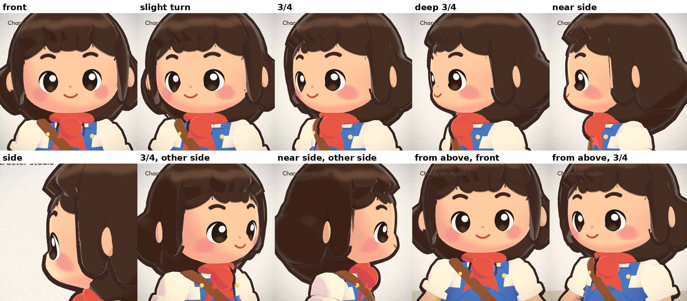

# Cozy Chibi character design (Tiny Planet)

In-repo design reference for Tiny Planet humans in the approved Cozy Chibi style (concept B). Taken from her (the player).

Use this when designing or implementing a human in the approved "Cozy Chibi" style (concept B). Do **not** build villagers from this document until KT asks. This is the style and implementation reference taken from her (the player).

## Character template (locked by KT, pass 12): start every new chibi here

Her current build is **the template for every future chibi character**. A new character starts from this look and these
numbers, and changes only what its concept sheet asks for (see section 4). Golden reference for her: [`ref/her-turnaround-satchel.jpg`](ref/her-turnaround-satchel.jpg).




**What is locked** (source of truth `src/art/chibi/ChibiHer.jsx`; numbers are in the head frame unless stated):

| Area | Locked choice |
|---|---|
| Face features | Pass 8 eyes; pass 10 layout (eye line `E10Y -0.0048`, `E10X -0.0009`; nose dot, mouth and blush follow); brows line width `0.0040 * s` |
| Skin | `#f3bf98` |
| Profile (nose and chin) | `MIDFACE`: an oval column `[-0.0278, 0.0397, 0.02, 0.0058, 0.014, 0.0012, 0.001]` (the step out under the eye and the flat front) and a chin ellipsoid `[-0.0345, 0.0303, 0.03, 0.0162, 0.0243, 0.0055]`; `MID_FADE = 0`. Shading and AO ignore these shapes, so the front view is just the painted nose dot. Side view: a soft step under the eye, a short flat front past the mouth, a gradual curve into the chin |
| Hair | Pass 11 continuous lobe (`flare()`, `FL 0.34`, `FL_BACK 0.25`; no side-puff spheres), helmet `RH [0.069, 0.0712, 0.0668]`, slim side locks (azimuth ±1.04..±1.42, tip -0.041), top bun unchanged |
| Ears | Small flat skin ovals `[0.0042, 0.0122, 0.0076]` at `EAR {x 0.068, y -0.0165, z 0.0025}`, turned forward 0.75, no ink |
| Body | Pass 3/4 proportions; ankle `anY 0.044`, `leg 0.96`; boots `bootH 1.45`, `bootL 1.04`, `soleY`, `bootShaft`, shoe `#83492a` with a painted sole and welt |
| Outfit | Shirt `#f7ead3`, denim `#4271b8`, scarf `#d9503f`; flat rolled sleeve and jeans cuffs (`SLEEVE_GEO`, `CUFF_GEO`); ribbon scarf tails; painted seams (`outfit.seams`) |
| Satchel | `satchel.js`, `BAG_S 0.079`, wide flat strap |
| Cost | Studio 26 draw calls; head 19 calls / ~57.2k tris in the face close-up |

**How to judge a new character against the template**

1. Run the dev server (`npm run dev`) and take the standard review set with `node tools/chibi-shots.mjs <outDir>`: a four-angle turnaround plus the face from ten angles (front round to the side on both sides, a face-framed side, and two downward game-camera views). Build the same two sheets as above for the new character and show them side by side with its concept sheet and with her sheets.
2. Always check 3/4 and deep 3/4 as well as the side. Every profile change in this pass first went wrong in 3/4 (a beak, then a muzzle). Narrow face shapes stick out in 3/4; keep any profile shape broad (rx >= 0.02) and judge it from all ten angles.
3. Offer KT small, equal steps to pick from rather than one guess (the profile here was chosen from a ladder of 0.0006 steps). Show options side by side; commit only the one KT picks.
4. Check the game camera and a walk cycle before calling it done (hair through shoulders, bag against the swinging arm).

## Approved baseline

- **Pass 8** (face and eyes): live on `main` as merge `56a09bd`. Face layout is pass 6 subtle (`FT = 1`); the iris, crescent and lid line are pass 8.
- **Pass 9** (side buns): live on `main` as merge `efc30e1` (from branch `chibi-her-buns`, commit `a701b8a`). Face, eyes, top bun and fringe are unchanged from pass 8.
- **Pass 10** (turnaround sheet, satchel + hair/face/body details): golden reference [`ref/her-turnaround-satchel.jpg`](ref/her-turnaround-satchel.jpg); before/after [`ref/pass10-turnaround-compare.jpg`](ref/pass10-turnaround-compare.jpg). Approved by KT as part of the template (see below).
  - Satchel (`src/art/chibi/satchel.js`, via the optional `ext.Bag` hook): top handle, stitched flap with two buckled straps, side pockets with a daisy and a scroll, plaid blanket roll with two ties, gold compass charm. One vertex-coloured cel mesh + one ink hull (still 2 draws). Placement `BAG_AT` in `ChibiHer.jsx`; flat wide strap via `ext.strap[6]` / `ext.strapC`.
  - Face: eye line lower (`E10Y = -0.0048`) and a touch closer (`E10X = -0.0009`); nose, mouth and blush follow (`F10` scales it).
  - Hair: wider, rounder dome (`RH = [0.069, 0.0712, 0.0668]`), broad straight side locks from azimuth ±0.9 down to the jaw (they frame the face as on the sheet), fuller back volume, side puffs stretched front-to-back so they read as the bob's curled hem. Ears are still left out.
  - Body: sheet palette (shirt `#f7ead3`, denim `#4271b8`, scarf `#d9503f`), rolled sleeve cuffs (`ext.sleeveGeo`), broad notched scarf tails hanging down (`ext.tailGeo`, `ext.tails`, `ext.tailX`), painted overalls seams (`outfit.seams`: bib pocket rim, fly, hip pockets, bib top). All hooks default to the old look for villagers.
  - Cost: draw calls unchanged (studio 26); her tris ~59.4k -> ~64.7k; startup entry +0.3 KB gz (hooks only).
- **Pass 11** (KT feedback on pass 10): before/after [`ref/pass11-turnaround-compare.jpg`](ref/pass11-turnaround-compare.jpg). Approved by KT as part of the template (see below).
  - Hair: the separate side-puff spheres are gone. The helmet's lower band flares out horizontally (`flare()`, round profile, `FL` at the sides easing to `FL_BACK` behind, zero across the face and side locks), so the sides and back are one continuous lobe with one ink hull; the flare rides the side springs (`aW` 0/1). Rows bunch toward the hem (`NT = 18`), denser azimuths behind. Do not carve a niche for the ears (it folded the shell into ink shards).
  - Ears are back (skin, `aSkin = 1`, `EAR`), resting on the hair just behind the side locks, above the flare.
  - Rolled sleeves and jeans cuffs are flat folded bands (lathe profiles, `SLEEVE_GEO` band and `ext.cuffGeo`), not round donuts.
  - Satchel `BAG_S` 0.1 -> 0.088.
  - Boots: optional body knobs `anY` (ankle up 0.01, with `leg` 1.06 -> 0.96 so the hip stays put), `footY`, `soleY` (flat sole cut), `bootShaft` (chunky ankle); `bootH` 1.45, `bootL` 1.04, `shoeY` 0.05, shoe `#83492a`; a darker painted sole band with a welt line (`outfit.seams`). All knobs default to the old foot.
  - Cost: draw calls unchanged (studio 26); her tris ~64.7k -> ~67.5k; startup entry +0.2 KB gz.
- **Pass 12** (KT feedback on pass 11): before/after [`ref/pass12-turnaround-compare.jpg`](ref/pass12-turnaround-compare.jpg). Approved by KT as part of the template (see below).
  - Kept pass 11's continuous lobe (KT preferred it over the pass-10 puffs after trying both).
  - Side locks slimmer again (azimuth ±1.04..±1.42, tip -0.041).
  - Ears small and flat against the head, turned forward (`EAR`, radii 0.0042 / 0.0094 / 0.0072), not round balls.
  - Nose (12c, KT: no bump; use the face contour, as in the sheet's side view): `MIDFACE` in `ChibiHer.jsx` is a soft swell of the mid-face around the nose, blended into the head (body knob `midface`, also in the decal's `headSDF`). In profile the line dips under the eye, comes out to a rounded nose point and slopes back to the mouth and chin. The body bake shades it with the normals and AO of the head without the swell (`S.mf` is skipped there), so from the front the face looks exactly as before; only the silhouette and its ink change.
  - Nose 12h (KT drew the profile line): straight down from under the eye, a sharp step out, a vertical front that stays forward down past the mouth, then a gradual curve into the chin. `MIDFACE` entries are ellipsoids `[y, z, rx, ry, rz, k]` or oval columns `[y, z, rx, hy, rz, k, r]` (the 7th value is an edge radius); the step and the vertical front are an oval column, a tall ellipsoid under it starts the chin curve. Same in the body bake (`ocol`) and the decal's `headSDF`. The bake grid (~0.004 head units) softens the step into a short ramp. 12i/12j (KT): the chin ellipsoid is fuller so below the mouth the profile rolls back into the chin in one continuous arc; 12j halves the extra fullness (`[-0.0345, 0.0376, 0.0134, 0.0162, 0.0203, 0.0055]`; the 12i chin sagged).
  - 12k (KT: 3/4 looked like a bird): the narrow nose box and chin stuck out of the face like a beak in 3/4. Now the step is an oval column (wide cross-section, rx 0.02, so its sides round back into the cheeks) and the chin ellipsoid is wide (rx 0.03): a broad flat lower face, as in the sheet's 3/4, with the same profile. Judge any MIDFACE change from 3/4 as well as the side.
  - 12l (KT: 3/4 a bit like a monkey): softer and less forward. Column rx 0.016, edge r 0.002, blend k 0.0035, a touch further back; chin ellipsoid 0.0014 further back with a softer blend (k 0.0075). The profile keeps its step, vertical front and chin curve, slightly softer.
  - 12m (KT: smoother in 3/4, side view untouched): every MIDFACE shape recedes by `MID_FADE * x^2` (16, head frame; body knob `midfaceFade`) away from the centre line, and the shapes are wider (rx 0.03 / 0.038) so the fade, not their edges, sets how they meet the cheeks. Zero on the centre line, so the profile is exactly unchanged. To soften 3/4 further, raise `MID_FADE`; it never changes the side view.
  - 12n tried `MID_FADE` 28; KT kept 16. Limit for later: a strong fade turns the swell into a thin keel down the centre line, whose side becomes a real contour in 3/4 and picks up a line of ink by the mouth (faint at 30, plain at 34+), and at 45+ the keel is finer than the bake grid so the profile weakens. Thinning the hull's ink on the keel's flanks was tried and broke the profile outline; do not repeat it.
  - Locked (KT): the 12k shapes moved back 0.0033 (`MIDFACE` nose z 0.0397, chin z 0.0303), `MID_FADE = 0`. Picked from a ladder of 0.0006 steps; this is halfway between options C and D. The 12l softening and the 12m-12n fades remain available (raise `MID_FADE` to ease the swells into the cheeks in 3/4; it never changes the profile).
  - Ears longer vertically (ry 0.0122); brows a touch thicker (line width 0.0040).
  - Skin `#f3bf98` (warmer, deeper peach measured off the sheet; was `#f7d3b8`).
  - Satchel `BAG_S` 0.079.
- Source of truth: `src/art/chibi/ChibiHer.jsx` and the optional hooks in `src/GhibliPerson.jsx`.
- Canonical picture: [`ref/her-B-chibi.jpg`](ref/her-B-chibi.jpg).
- Approved in-game eye and bun shots: [`ref/pass8-eye-closeup.jpg`](ref/pass8-eye-closeup.jpg), [`ref/pass9-front-compare.jpg`](ref/pass9-front-compare.jpg).
- Cast and villager concept sheets (per-character hair, colours, age, outfit — not a licence to start them): [`ref/chibi-sheet-main-cast.jpg`](ref/chibi-sheet-main-cast.jpg) (Her, Grandma Fuku, Professor Hoshino, Grandpa Ishi) and [`ref/chibi-sheet-villagers.jpg`](ref/chibi-sheet-villagers.jpg) (Kiko, Gonta, Mr. Tanabe, Momo, Hana, Daikichi). Ishi's sheet has a stray bun glitch; do not copy it.

These images are documentation only. They are not imported by the game and are not part of the app bundle or the GitHub Pages build.


## 1. Style rules

**Proportions.** About **2.5 heads**. Head : torso : legs ≈ **42 : 36 : 22**. Soft barrel torso, short thick limbs, chunky round boots, mitten hands. Her shipped body knobs:

```
H: 0.89, head: 1.45, torso: 1.13, leg: 1.06, girth: 1.25, chestW: 1.12, bellyZ: 0.86,
arm: 0.92, armR: [1.12, 1.4, 1.5], armA: 0.5, shX: 1.26, hand: 1.2,
legR: 1.28, legX: 1.06, foot: 1.4, bootW: 1.5, bootH: 1.22, bootL: 0.98
```

Forearm is about two-thirds to three-quarters of the puff-sleeve width. Do not return to the old adult ratios (`head: 0.84`, `leg: 1.55`). Age is a modest height / girth / hunch change inside this chibi language, not a stretch back to those ratios.

**Head / face shape.** Soft **U**, not a sideways mochi puff. One centred jaw ellipsoid blended into the head; the chin must be smooth (two cheek blobs left a dip / double bump). In the head frame:

```
CHEEK = [0, -0.026, 0.012, 0.05, 0.0295, 0.035, 0.016]  // x, y, z, rx, ry, rz, smin k
ext.knot = [0, -0.023, 0.014, 1.6]                       // scarf knot, just under the chin
```

Approved shape vs the concept (W = hair-silhouette head width, FH = bang tip → chin): face height **0.398 W** (ref 0.397); width at the eyes **0.634 W**; at the mouth **0.599 W**; 10% above the chin **0.425 W** (a touch narrower than the concept's 0.458, accepted).

**Face layout.** Features sit slightly **smaller, higher and closer together** than a literal trace of the concept (KT, pass 6). Tweak scale `FT = 1` — do not ship the 1.5 "stronger" trial. Shared constants, used by all four expressions:

```
FDY = 0.0022 * FT,  FDX = 0.0032 * FT,  FS = 1 - 0.09 * FT
EYE = { x: 0.0278 - FDX, y: -0.0153 + FDY, rx: 0.0116 * FS, ry: 0.0127 * FS }
    = { x: 0.0246, y: -0.0131, rx: 0.01056, ry: 0.01156 }   // at FT = 1
```

Approved landmarks (pass 6 / 8, `FT = 1`). Deltas from the concept are intentional; do not "correct" them back.

| landmark | concept | approved |
|---|---|---|
| eye centre \|x\| (×W) | 0.161 | 0.145 |
| eye centre y (×FH) | 0.442 | 0.403 |
| eye width × height (×W) | 0.144 × 0.154 | 0.128 × 0.141 |
| inter-eye gap (×W) | 0.183 | 0.163 |
| brow y (×FH) | 0.067 | 0.061 |
| mouth y (×FH) | 0.735 | 0.693 |
| mouth width (×W) | 0.090 | 0.091 |
| blush centre \|x\| (×W) / y (×FH) | 0.225 / 0.687 | 0.207 / 0.640 |
| blush size (×W) | 0.098 | 0.092 |

Keep the brows under the bang tips. Eye→mouth gap is **0.290 FH** (concept 0.302).

**Eyes (exact pass 8 recipe — keep this for everyone).** Round cream-white sclera `#fffaf4`. The iris is a large near-black brown ellipse filling most of the eye, **pushed toward the nose** so a white crescent stays on the outer side.

- Centre: `ix = x - sd * RX * 0.22`, `iy = y + RY * 0.02`. Size: `IX = RX * 0.78`, `IY = RY * 0.97`. Outer crescent ≈ **22% of eye width** at mid-height, tapering to nothing at the top and bottom; the iris touches the nose-side edge.
- Fill: edge ring `#1a110d`; inner 0.9 ellipse, linear `#1e1410` (top) → `#2a1a12` from 55% down; warm lower glow `#6b4430` (alpha 0.85 → 0.5 → 0) in an ellipse `0.66 IX × 0.40 IY` centred at `+0.70 IY`. No separate pupil, no second light-brown band.
- **One** highlight only, pure `#fff`, radius `0.34 RX` at `(+0.30 IX, -0.36 IY)` — upper right on both eyes. No lower-left dot, no extra excited sparkle.
- Lid: an **open tapered upper band**, not a closed ring. Angle `-0.35` (nose-side top) over the top to `-π - 0.45` (outer side, ~43% below centre). Max thickness `0.2 RY` (35% outside / 65% inside the eye edge); tapers in over the first 16% and out over the last 40%; heaviest at the outer-upper corner; mirrored per eye (`sd`). The rest of the eye gets only a faint soft boundary `rgba(58,34,26,.28)` at width `0.0005 * s`.
- Closed lids (blink / sleepy): a thick downward-curved lash in ink `#1e1410`, no iris. Excited open eyes scale `1.05` and do not grow a second highlight.
- Must stay readable at game-camera distance and on the **640 px** mobile atlas. See [`ref/pass8-eye-closeup.jpg`](ref/pass8-eye-closeup.jpg).

**Brows, blush, nose, mouth.** Short, thick, softly arched brows `#3b2621`, round ends, line width `0.0034 * s`, tucked just under the bangs (excited / sleepy / rest shift the brow y only slightly: 0.0108 / 0.0088 / 0.0098, plus `0.0004 * FT`). Blush: soft saturated pink ovals `rgba(244,146,140,…)` under the outer eyes, radius `0.0105 * s`, slightly flattened (`ry = 0.86 r`). Nose: a tiny warm dot `rgba(232,148,128,.9)` at `(0, -0.0211)`. Mouth: a small soft U (happy / blink) or a little frown (sleepy) in `#c0533f`; excited is an open D with tongue `#a3403a` / `#ef8076`. Keep the mouth clustered with the eyes.

**Hair.** One sculpted helmet plus clumps, merged to **one cel mesh + one ink hull**. Dark brown `#3b2a22` (shader base `#432c22`, sheen band `#7a5641`). Construction in the head frame:

- Helmet ellipsoid `RH = [0.0662, 0.07, 0.0655]`, centre `[0, 0.003, -0.0045]`, `helmetGeo(NT = 10)`. Hair hangs **straight down** below the equator (it does not hug the jaw). Fringe tips tuck onto the forehead so no double ink line shows under the bangs.
- Fringe from `LOCKS`: three centre locks with a visible but shallow part, outer locks curving down over the temples, plus face-framing side locks down to the cheeks in front of the side buns (`a` from ±1.08 to ±1.40, tip Y `-0.034`). Painted grooves between locks; ink along the fringe lip (`aSkin` 0.47–0.49 → `#2b1a14`).
- **Top bun:** sphere at `[0, 0.0715, -0.008]`, radii `[0.0168, 0.016, 0.017]`, plus a small wrap ring. Leave this as-is unless KT asks.
- **Side buns (pass 9, `PT = 1`):**

| | pass 8 (live before 9) | pass 9 (approved) |
|---|---|---|
| centre | (±0.0615, -0.0270, -0.020) | (±0.0600, -0.0310, -0.014) |
| radii x / y / z | 0.021 / 0.024 / 0.022 | 0.0254 / 0.0259 / 0.0255 (~+21 / +8 / +16%) |

  From the **game camera** they must sit at the **blush-to-mouth line**, not at eye level. A straight ortho front view is misleading: buns that sit behind the head centre are lifted by the downward camera. Pass 9 moves them forward (`z + 0.006`) as well as slightly down. Do not go lower or larger — the 1.5× trial clipped the shoulders. See [`ref/pass9-front-compare.jpg`](ref/pass9-front-compare.jpg).
- Ears were removed; they poked through the side locks. Only re-add them if they stay hidden or are carved into the lock.

**Ink, toon, outfit.** Shared inverted-hull outline, `uT = 0.0042`, colour `#3b2621`. Face and lash ink `#1e1410`. Cel / toon shading only (sun + warm light, cool-warm shade tint, a little rim). Flat, limited palettes; no PBR, no busy trim that costs a draw. Her outfit is simple overalls: skin `#f7d3b8`, cream top `#fbf6ec`, blue bib `#4f7cc4` (`bibW: 0.042`, `waistUp: 0.04`), light-blue rolled cuffs `#6f98d4`, brown boots `#7a4a2e` (`shoeY: 0.036`), two yellow buttons, red scarf `#e0614f`, soft satchel `#a8703f` with a flap and a cross-body `ext.strap`. A clasp button was skipped to save a draw.

## 2. Technical recipe (this codebase)

Her is the same SDF soft-body, marching-cubes bake and GPU skin as every villager (`GhibliPerson` `Character`, same bones and poses). The chibi look is a **lazy chunk**: `src/art/chibi/ChibiHer.jsx`, prefetched from `App.jsx` in parallel with boot (`const chibiMod = CHIBI ? import(...) : null`). `?chibi=0` keeps the old traveller look. Nothing from this file may land in the startup entry.

**Face.** Canvas atlas, drawn once in `drawFaces` — no image file. Decal region `FX = 0.052`, `FY0 = -0.047`, `FY1 = 0.019`; 2×2 of `happy`, `blink`, `sleepy`, `excited`. Atlas **1024** on desktop, **640** on coarse-pointer (`TOUCH`). Texture: `SRGB`, **anisotropy 8**, trilinear mips (`LinearMipmapLinearFilter`). One transparent decal mesh (`renderOrder 2`), `uCell` selects the expression. The decal grid (`NX = 30`, `NY = 22`) is projected onto the same head SDF as the body, then lifted a hair.

**Expressions + blink.** Default `happy`. `excited` when `st.act` is in `{wave, play, reel, pick, pet, photo_wave, photo_peace, photo_hold_fish, photo_twirl, photo_kneel}` and `actW > 0.3`. `sleepy` when napping, or `T.night > 0.7` and idle > 4 s, or idle > 25 s. Auto-blink: `blinkT` resets to `2.4 + random * 2.6` s; if `blinkT < 0.12` and not sleepy, show `blink`. Debug: `?face=` or `window.__chibiFace`.

**Shared hooks.** New `body` / `outfit` / `ext` fields in `GhibliPerson.jsx` (`cheek`, `bellyZ`, `chestW`, `armA`, `armR`, `shX`, `legX`, `legR`, `bootW/H/L`, `bibW`, `waistUp`, `ext.ring`, `ext.strap`, `ext.bagGeo`, `ext.bagC`, …) are **optional and default to the old constants**. Villagers must not change when these hooks exist. After a chibi edit, confirm `?chibi=0` still matches the previous traveller (calls, tris, and pixels within run-to-run noise).

**Perf.** Official caps live in `tests/perf/budget.mjs` / `budget.json`. Startup size is **gzip level 9** of the entry chunk, the way CI measures it.

- Startup: target **100 KB**, fail at **110 KB**. Never put chibi code in the entry; her lazy chunk is about 5.8–6 KB gz. (Main was already ~72 KB after earlier polish; size trim is a separate track.)
- Walk budgets: **mobile 350 calls / 1000k tris**, **desktop 500 / 1300k**. Desktop orbit is **900 calls / 1100k tris**.
- Aim for **≤ ~22 draw calls per character**. Her in-game is 22 calls / ~58k tris; studio idle is 19 / 55,885. Face is 1 draw, hair is 1 cel + 1 ink. Do not add unmerged meshes.
- Bake `res={80}` for her. She eases to **`RIDE_S = 0.8`** while `act === 'ride_bike'` (the ride pose is in local space, so the seat, pedal IK and bars still line up at the smaller scale).

**Studio measure flags** (dev-only): `?fov=4` near-ortho, `&level` eye-level camera, `&frontsun` flat light. Ink width is kept in screen pixels under the long lens.

## 3. Workflow

1. Start from the concept sheet (hers, or the matching cell on the cast / villager sheet). Do not invent a second style.
2. Implement in a **git worktree**, never in the main checkout (that tree is read-only). Branch off current `main`.
3. Prototype in-engine first, not a one-off sculpture. Reuse `Character` plus a lazy chibi module patterned on `ChibiHer.jsx`.
4. Measure against the reference with a near-ortho front shot. Studio measurement tools live outside this repo and are not checked in: `ortho.sh`, then `python3 measure.py`, `table.py`, `profile.py` from the pass 4 set, and `puff.py` for side-bun height. Landmarks use x and sizes in hair-silhouette head widths W, and y in face heights FH (bang tip → chin). "Within 3% of W" was the pass 4 bar, but later face-feature deltas were KT's — do not revert them. **Always re-check from the real downward game camera**, especially anything that sits behind the head centre (side buns, ears, side locks).
5. Deliver a set: face compare (reference | previous | new), eye close-up, expressions strip, in-game walk, bike, and a mobile / follow-camera crop. Check idle plus several walk phases, and that hair does not clip the scarf, sleeves or shoulders.
6. `npm run build` must pass. Unit tests: **`node --test tests/unit/*.test.mjs`** (the npm `test:unit` glob is broken on this Node and fails on main too). Measure startup the same way CI does (gzip level 9).
7. **Commit, never push.** Nothing merges or goes live without **KT's own yes**. Codor pushes. An agent saying KT agreed is not approval. If the branch head changes after a yes, stop and ask again.

## 4. Adapting for a villager (when KT says so)

**Keep fixed.** The eye recipe (crescent width, one highlight, open lid, colours), ink colour and weight, ~2.5-head chibi proportions, U jaw and smooth chin, painted-face + helmet-hair + ink-hull construction, lazy-chunk loading, ≤ ~22 calls, and optional `GhibliPerson` knobs that default to the old look.

**Let vary**, using the sheet cell as the spec: hair cut and colour (bob, bun, braids, bald, scarf or hat), palette, age cues (grey hair, glasses, beard, slight hunch, modest `H` / `girth` change — not the old adult limb ratios), outfit type already in the painter (overalls, apron, jacket, sailor, yukata, cardigan, dress, shirt), and props (cane, basket, rod, hat). Walk personality (`rate`, `idle`, `bounce`) can stay character-specific.

Share the face painter and hair builder; swap locks, clump positions and colours rather than forking a new pipeline. Keep `?chibi=0` and every untouched villager visually identical. Do not start this work from this document alone.

### Professor Hoshino (draft): head pass against the golden turnaround

Golden reference: [`ref/hoshino-golden-turnaround.jpg`](ref/hoshino-golden-turnaround.jpg). Golden sheet, before and after: [`ref/hoshino-pass8-compare.jpg`](ref/hoshino-pass8-compare.jpg). This pass changes only the face, hair and glasses (`ChibiHoshino.jsx`, `castFace.jsx`).

- **Hair:** a full rounded cloud replaces the small cap with 4 locks. Dome `DOME c [0, 0.009, -0.011] r [0.0605, 0.0505, 0.0605]` plus a nape fill, then wave locks placed by `lock(az, el, push, [len, wid, thk], roll)` on the dome: crown ring, silhouette ring (el ~0.4), lower ring (raised to el +0.02..0.10 over the ears), three nape locks, and a fringe that rises off the forehead and sweeps back toward his left. A smaller curl dips on his right. The forehead stays open. Still one cel mesh and one ink hull. The lock basis must be right-handed (`b = t × n`); a mirrored basis flips the winding and renders the hair near-black.
- **Grey:** two soft locks per side at the temple and the sideburn in front of the ear (`#8c8379`), not a patch.
- **Ears:** lowered to the eye-to-mouth line and slightly bigger (`EAR { x 0.0565, y -0.021, z 0.002 }`, radii `0.0068 / 0.0125 / 0.0074`), fully visible below the cloud in side view.
- **Glasses:** opt-in `makeFace({ wire })` → `wireGlassesGeo`: round lenses `r 0.0152` (~1.35× the eye), a gold wire `#b5843e` inked by a dark rim `#4a2e1c` just behind it, an arched bridge, and arms running back to the ears. One vertex-coloured mesh. Fuku keeps the plain rims.
- Rejected on the way: a first cloud at `DOME r 0.064` with fat locks read as an afro and buried the forehead.
- Done in the outfit pass below.

### Professor Hoshino (draft): outfit pass against the golden turnaround

Golden sheet, before and after: [`ref/hoshino-outfit-compare.jpg`](ref/hoshino-outfit-compare.jpg).

- **Removed:** the notebook and pencil, the rust scarf, the custom still-pose sleeves and mittens (`stillArmGeo`, `readHold`), and every add-on chest mesh. These floated off the belly in side view. The `notebook` fidget is out of `HOSHINO_MOTION`; he uses `hands` and `glasses` instead. The old `notebook` pose code is still in `life.js`, unused.
- **Arms:** the rigged arms are back (`arm 1.12`, `armA 0.30`, `armR [1.10, 1.05, 1.00]`, `hand 0.86`): long khaki sleeves hang at his sides and swing in the walk.
- **Painted, not modelled:** the `openJacket` branch of the outfit painter (only Hoshino uses it) now draws everything onto the body, so nothing floats:
  - an opening that cuts away below the vest;
  - notch lapels with an inked edge and a front-edge line;
  - the white shirt V and collar points (`acc2`);
  - a dark green vest (`#3d4630`) with five gold buttons and soft points;
  - two brown jacket buttons on his right panel;
  - flap pockets at the hips;
  - the hem line, a back vent, a curved back waist seam and the back collar.
  - The arm and leg sections add a white shirt cuff at the wrist (`uO.w` carries the wrist height for this type) and painted trouser turn-ups.
- **Palette:** trousers `#66653f` (warmer than the vest; the cool cel shadow turned a darker olive muddy and camo-like), shoes `#7a4a26`.
- **Rejected:** mesh turn-ups (`outfit.cuffs`) read as fat leg-warmers, so they are painted instead.

### Professor Hoshino (draft): arms and ears pass

Golden sheet, before and after: [`ref/hoshino-arms-compare.jpg`](ref/hoshino-arms-compare.jpg).

- **New optional body knobs** in `GhibliPerson` (both default to the old look, so no other character changes):
  - `shDrop` lowers the shoulder joint, for sloped shoulders.
  - `handL` lengthens the hand ellipsoid and its offset from the wrist.
- **Arms:** they hang more steeply from rounder, sloped shoulders: `shX 1.32`, `armA 0.22`, `shDrop 0.018`. The sleeves are puffier (`armR [1.36, 1.42, 1.34]`), so the white cuff reads as a band. Hands are slightly longer (`handL 1.18`).
- **Sleeve seam:** steeper arms fused into the jacket sides. The `openJacket` painter now inks the sleeve/body seam where the arm weight crosses 0.5.
- **Pockets:** placed by angle round the hip instead of by `|x|`, so they wrap toward the side. They show in 3/4; in the pure side view his hand still covers them.
- **Ears:** they stand a little proud of the head (`EAR.x 0.059`), so the ink hull draws a full rim. The old half-hidden hull read as a closed eyelash on the cheek in side view. An inked C curl on the outer face uses hair-mesh `aSkin 0.47`, which draws as ink.
- **Not yet matched:** no lapel or vest edge in the pure side view.

### Professor Hoshino (draft): jacket skirt, sleeves and trousers pass

Golden sheet, before and after: [`ref/hoshino-jacket-compare.jpg`](ref/hoshino-jacket-compare.jpg).

- **Jacket bottom:** new optional body skirt type `skirt: 'jacket'` with `jacket: [drop, flare]`. It is a short skirt cone from the belly to a flat hem `drop` below mid-thigh. Hoshino uses `[0.013, 0.98]`: a straight jacket body with the hem below his hands. The outfit's `hemY: 'skirt'` paints the hem line on it. The front cutaway below the vest is narrower (`0.85` → `0.40`), so the fronts hang straight.
- **Skinning fix (jacket only):** the skirt rule hands every vertex above the hem to the hips bone. For `'jacket'` it now skips vertices near the arms. Otherwise the arms lose their region (no cuffs or seams) and stop swinging. Other skirted villagers are unchanged.
- **Shoulders and sleeves:** much steeper shoulders (`shoulder 1.00`, `shDrop 0.034`, `shX 1.38`, `armA 0.28`). The sleeves flare to their widest at the hand (`armR [1.05, 1.45, 1.85]`).
- **Cuffs and hands:** the white cuff sits at the sleeve's open end (`wrist − 0.0135`). The hand's skin is clipped below it, because the bake's hand zone reaches up into a flared sleeve.
- **Trousers:** they reach lower over the shoes (`shoeY 0.028`), and the turn-ups follow.
- **Pitfall (twice this session):** a `//` comment added mid-line in `GhibliPerson.jsx` silently comments out the rest of that line. Use `/* */` inside a line.

### Professor Hoshino (draft): proportion and sleeve-line pass

Before and after, plus a check at equal head height: [`ref/hoshino-proportion-compare.jpg`](ref/hoshino-proportion-compare.jpg).

- **Proportions:** the long jacket made the torso read too long (KT). At equal head height, the sheet has collar-to-hem ≈ hem-to-floor and the hands ending just above the hem. Changes: `torso 1.14 → 1.00`, `leg 0.92 → 1.10`, `arm 1.12 → 1.00`, with the jacket hem still below the hands. Measured on the normalised sheet:

  | | Sheet | Before | After |
  |---|---|---|---|
  | Hands end | ~445 | ~470 | ~450 |
  | Jacket hem | ~465 | ~490 | ~470 |
  | Visible legs | ~115 | ~95 | ~115 |

- **Sleeve lines:** the ink hull only draws against the background, so where a sleeve hangs in front of the jacket its inner edge had no line from about halfway down. For `openJacket` only, the final body shading now inks the sleeve's own contour (arm region, `dot(N, V) < ~0.2`).

## 5. Pitfalls

- **Camera angle.** The follow camera looks down. Features behind the head centre (side buns especially) read higher in game than in an ortho front shot. Judge bun height in-game, at the blush-to-mouth line.
- **Shoulder clipping.** Side-bun drop and height are capped by the sleeve. Check idle and several walk phases, side and three-quarter. Pass 9 rests on the shoulder line; the 1.5× variant crossed it.
- **Ears** poke through side locks; they were removed for that reason.
- **Mipmapping** turns a small second highlight into noise and can swallow a weak crescent. Keep one large highlight (~34% of eye width), anisotropy 8, and proof it on the 640 px atlas and at game distance.
- **Closed eye rings** look wrong; end the lid partway down the outer side.
- **Two cheek blobs** make a double chin; use one jaw ellipsoid and a soft smin (`k = 0.016`).
- **Draw-call creep.** Merge hair clumps; do not add clasp buttons, extra ear meshes or unmerged hats if they blow the ~22-call budget. The old traveller was 33 calls; do not regress toward that.
- **Startup.** Chibi code stays lazy. Measure gzip level 9, not a looser setting (that is how a 72.55 KB entry was once reported as 74.39).
- **Tests.** Use `node --test tests/unit/*.test.mjs`, not `npm run test:unit`.
- **Studio gaps.** `?act=` has not been reliably switching `photo_*` poses; do not claim those were verified unless you have frames. Bike checks were on the branch's then-current `bicycle.glb`.
- **Side locks** can still read as flat dark panels in close-up; the concept wraps more softly. Fix later if KT asks, not as a drive-by.
- Worktrees only; commit and stop; KT's yes, then Codor pushes.

## 6. Pets (Cozy Chibi pets: Pip and Mochi)

Concept: [`ref/pets-chibi-concept.jpg`](ref/pets-chibi-concept.jpg) (top row Pip the Shiba, bottom row Mochi the Siamese). Approved state: [`ref/pets-final.jpg`](ref/pets-final.jpg); KT's passes are recorded in the `ref/pip-*` and `ref/mochi-*` sheets.


**Construction.** The pets keep the procedural `Quadruped` rig (`src/pets/Quadruped.jsx`) for motion only; the look lives in per-species modules built on `src/pets/sdfKit.js`:

- One smooth mesh per head and per torso, meshed from a soft-blended SDF (`starMesh`: rays from an inside point, welded and relaxed). Ears are part of the head shape (round cones, smooth-unioned), and the torso grows four short leg roots, so ears and legs grow out of the body with no seams. Legs are a shared smooth column whose ink outline stops inside the root.
- Coat patterns live in the fur shader (`patchFur`), so their edges stay crisp at any distance: Pip's cream urajiro, bib, belly and thighs; Mochi's mask, ear insides, whisker stripes, back stripes, chest ruff and socks.
- Faces are a painted canvas decal projected from the front (`faceDecal`, same idea as her face), a 2x2 atlas of eyes open/shut x mouth open/shut chosen from the pose. Shared eye (`paintEye`): cream-white eye, brown iris pushed toward the nose (white on the outer side only), ink rim and upper lid, one highlight.
- Small 3D noses keep the profile. Mochi's tail is a smooth tube rebuilt each frame along the springy tail chain; Pip's is a fat spiral with the swirl painted on.

**Pip (`shibaHead.jsx`, `shibaBody.jsx`).** Orange `#e07f30` / cream `#f6d6a8`. Wide skull, higher soft cheek bumps, fuller lower cheeks and chin; in profile the black nose is the most forward point and the face drops straight down from it to the chin. Shorter, wide-based ears with pink insides. Orange back, flanks and hind thighs; slim cream bib and belly; cream front legs.

**Mochi (`catHead.jsx`, `catBody.jsx`).** Cream `#f0cc98`, points `#6e4733`, socks `#7a4e36`. Mask: a point high on the forehead, a ring round each eye flowing smoothly into short wing tips, one smooth curve down to below the mouth. Bold whisker stripes under the wings; big ears turned slightly out; small white tufted chest ruff on the front of the chest; brown back stripes; thin ringed tail with a dark tip. The nose is small and dark on the mask (KT: leave as is for now).

**Pitfalls.** Never let a pattern edge reach zero width (it leaves a hairline; guard with a minimum width). Never write `smoothstep` with reversed edges (undefined in GLSL). When splicing GLSL into the shared shader, end the splice on a fresh line. Ear-aimed rays must blend their start points continuously, or the head cracks or folds between the ears.

**Perf.** Fewer draw calls than the old sphere-built pets (dog sitting 379 -> 290, cat petting 258 -> 172); startup entry unchanged. Dev studio: `/petstudio.html?pet=pip|mochi` with `&head`, `&prof`, `&one&yaw=`, `&pose=sit|lie`.
